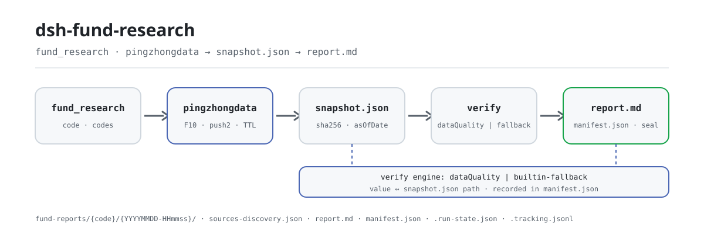

<div align="center">

<picture>
  <source media="(prefers-color-scheme: dark)" srcset="docs/assets/dsh-fund-research-flow-dark.svg">
  
</picture>

# dsh-fund-research

**Enter a six-digit fund code, get a sealed research report whose every number is traceable and whose gaps are declared.**

A research plugin for Chinese public mutual funds on DeepSeek Harness: it collects public data from Tiantian Fund / Eastmoney endpoints politely, computes every metric deterministically in code, and seals the report together with its source snapshot into your workspace — research only, not investment advice.

[Install](#three-step-setup) · [Configuration](#configuration) · [FAQ](#faq) · [简体中文](README.md) · [English](README.en.md) · [Español](README.es.md) · [Português](README.pt.md) · [हिन्दी](README.hi.md)

[](LICENSE)
[](#compatibility)
[](https://www.npmjs.com/package/dsh-fund-research)
[](https://github.com/PerryLink/dsh-fund-research/actions/workflows/ci.yml)
[](#compatibility)

[](https://github.com/PerryLink/dsh-fund-research/stargazers)
[](https://www.npmjs.com/package/dsh-fund-research)
[](https://dshfind.com/plugins/PerryLink/dsh-fund-research?ref=badge)
[](https://securityscorecards.dev/viewer/?uri=github.com/PerryLink/dsh-fund-research)
[](https://dsh.market/)
[](https://gitee.com/perrylink/dsh-fund-research)

```sh
dsh plugin --profile <name> add dsh-fund-research
```

</div>

<sub>Community plugin, not affiliated with DeepSeek. Canonical repository: <https://github.com/PerryLink/dsh-fund-research> (Gitee is a mirror).</sub>

## What it is

Give the model a six-digit fund code and `dsh-fund-research` collects that fund's public data, runs a deterministic metric suite, checks every key number against the source snapshot before sealing, then writes the report — together with the snapshot, the acquisition record, and the manifest — into your workspace. Every number in the report appendix has a value ↔ snapshot JSON path ↔ verdict row, so you can recompute it from `raw.*` with the documented conventions and audit the plugin itself. When a data source fails or degrades, the affected section carries an explicit data-gap declaration; the plugin never fills a gap with an invented number. Pure host plugin: no trading, no predictions, not investment advice.

## Three-step setup

1. **Install** (pick one channel):

   ```sh
   # npm channel (published releases)
   dsh plugin --profile web add dsh-fund-research
   # git channel (latest main)
   dsh plugin --profile web add github:PerryLink/dsh-fund-research
   # tarball channel: pnpm pack in this repo, then
   dsh plugin --profile web add ./dsh-fund-research-<version>.tgz
   ```

   Restart the profile after installing (bundle activation is restart-based). The shipped profiles compose the storage stack through `dsh-base` (`dsh-storage` + `dsh-storage-json` + `dsh-storage-domain`); the bundle patch mounts only the plugin row. A bare profile must compose the storage stack itself, otherwise the plugin cannot mount.

2. **Minimal config** (defaults work; override the report root and collection policy as needed):

   ```yaml
   - insert:
       - id: dsh-fund-research
         name: dsh-fund-research
         config:
           offline: false
           reportRoot: fund-reports
           cacheTtlHours: 12
   ```

3. **Verify it works**: just ask the agent; the plugin calls `fund_research`:

   ```text
   > use fund_research to produce a research report for 161725
   ```

   A moment later the workspace holds a versioned directory:

   ```text
   fund-reports/161725/20260819-153012/
   ├── snapshot.json            # raw extracted data + computed metrics + per-source sha256
   ├── sources-discovery.json   # code-generated endpoint roster + coverage + gaps
   ├── report.md                # the research report with the traceability appendix
   └── manifest.json            # snapshot/report hashes, parameters, verify engine, gaps
   ```

**Uninstall**: `dsh plugin --profile web remove dsh-fund-research` (or remove the row from the profile patch).

### Examples

These are the plugin's real entry points; install once, then call one.

**Detailed example** — command:

```sh
fund_research({ code: "161725", sections: ["overview", "disclaimer"] })
```

Output:

```text
招商中证白酒指数(LOF)A（161725）研究报告已封存 — 仅供研究参考，不构成投资建议
版本目录 20261019-124928；报告 fund-reports/161725/20261019-124928/report.md
manifest fund-reports/161725/20261019-124928/manifest.json（报告 sha256 f74b1446d544…）
数字回溯表核查（builtin-fallback）：verified 5 / mismatch 0 / not-found 0 / unverifiable 0
采集方式：快照复用（offline）；章节：overview、disclaimer
```

*Observed from `README.md:99-113,149-161; test/tools.spec.ts:150-171; src/tools/research.ts:121-130`*

**Failure branch** — input:

```text
{"code":"161725","asOfDate":"2024-02-30"}
```

Output:

```text
isError=true; error.message=asOfDate must be a real calendar date, got "2024-02-30"
```

*Observed from `plugins/dsh-fund-research/src/sources/snapshot.ts:167 (parseAsOfDate); plugins/dsh-fund-research/README.md:173 (invalid dates fail loudly); exercised through plugins/dsh-fund-research/test/harness.ts`*

**Brief examples**: `fund_snapshot`

## Core capabilities

`dsh-fund-research` splits one research run into four stages — collect → compute → verify → seal — and every stage leaves a re-checkable artifact:

- **`fund_research` tool** — one fund code in, a versioned Markdown research report out: overview, performance decomposition, holdings penetration, simplified style attribution, manager profile, benchmark & peer comparison, risk & gap declarations, disclaimer, and a **number-traceability appendix** mapping every key figure to its snapshot JSON path and verification verdict. Sealed to `fund-reports/{code}/{YYYYMMDD-HHmmss}/` as `report.md` + `manifest.json` + `snapshot.json`. `background: true` runs it as a `fund-report` background job.
- **`fund_snapshot` tool** — a light snapshot card (latest NAV, published stage returns, scale, manager, top-3 holdings) sealed into the fund's day directory.
- **Deterministic metrics, zero model arithmetic** — period/annualized return, volatility, max drawdown, Sharpe; top-N concentration, HHI, industry distribution, quarter-over-quarter holdings comparison; size-value style bands; manager tenure and peer comparison. All pure functions over the sealed snapshot.
- **Traceability as a first-class feature** — before sealing, every key number is checked against the sealed `snapshot.json` through the optional [`dsh-data-quality`](https://github.com/topics/dsh-plugin) service when it is installed, or through the built-in isomorphic fallback checker (`builtin-fallback`) otherwise. The appendix table records value ↔ path ↔ verdict.
- **Honest gaps** — a failed or degraded data source produces an explicit data-gap declaration in the affected section. The plugin never fills a gap with an invented number.
- **Offline mode** — `offline: true` (config or tool argument) serves everything from the storage-domain snapshot layer or the newest on-disk version snapshot, with zero outbound requests. Ideal for tests and reproduction.
- **asOf cutoff** — `asOfDate` (ISO `YYYY-MM-DD`) truncates the NAV series to data on or before that date and stamps the snapshot + report with the cutoff; invalid or future dates fail loudly.
- **Checkpoint resume** — `<reportRoot>/.run-state.json` records each pipeline stage (snapshot/report) with timestamps and an input fingerprint; `resume: true` continues from the first incomplete stage, reusing sealed artifacts, and rejects a fingerprint mismatch.
- **Source discovery record** — every acquisition seals a code-generated `sources-discovery.json` (endpoint roster, primary/fallback resolution, per-source coverage and gaps, degradation reasons) and folds it into the report appendix as a data-source & gap declaration.
- **Multi-fund fan-out** — `codes` accepts an array of fund codes; each fund runs the pipeline independently with per-fund failure isolation (failures become summary gaps), and the result is a summary card (code / asOf / seal hash / verdicts / failure reason).
- **Tracking ledger** — every successful seal appends a deterministic line to `<reportRoot>/.tracking.jsonl`; `includeComparison: true` renders a deterministic comparison-with-last-run section (NAV range / scale / top holdings) with a gap declaration when no prior record exists.
- **Read-only review** — after sealing, a `fund-review` job reviews the sealed artifacts (gap-declaration completeness, traceability-table consistency, disclaimer) and writes `review-note.md`; it skips gracefully (recorded in run-state) when no jobs service is present.
- **Per-source quality signals** — every source carries deterministic quality metadata (`requested`/`succeeded`/`fieldsPresent`/`parseWarnings`/`degraded`), rendered in the appendix and surfaced in tool values so downstream can downweight (never hard-filter) a low-quality source.
- **Walk-forward stability summary** — `includeWalkForward: true` adds an out-of-sample stability summary section: deterministic rolling-window return/Sharpe sign persistence and mean/std, explicitly labelled as statistical description only, not a prediction.
- **Session audit events (host-dependent)** — `fund-research/snapshot` and `fund-research/report` log-only events carry the code, version directory, manifest hash, and gap list (model-visible ⟺ logged) *when the host admits out-of-repo event types*; on `0.1.2-alpha.1`–`0.1.5-alpha.1` hosts the known-type catalog is build-generated in-repo, so the gate appends nothing and the tool results plus sealed artifacts are the audit trail.
- **Methodology skill** — a bundled `fund-research` skill teaches the model the metric conventions, gap handling, and compliance wording. Computation stays in code.

### Tools & surfaces

**`fund_research` arguments**:

| Argument | Type | Description |
|---|---|---|
| `code` | string | Six-digit fund code, e.g. `"161725"` (single fund). Mutually exclusive with `codes`. |
| `codes` | string[] | Multiple six-digit fund codes: a fan-out with per-fund failure isolation (returns a summary). Mutually exclusive with `code`. |
| `sections` | string[] | Section ids to render (`overview`/`performance`/`holdings`/`style`/`manager`/`benchmark`/`risk`/`disclaimer`). Default: all. |
| `offline` | boolean | Read the snapshot layer only (no network). Default: plugin config. |
| `asOfDate` | string | ISO 8601 date (`YYYY-MM-DD`) cutoff: only data on or before it is used (NAV series truncated). Empty = no cutoff; future dates fail loudly. |
| `resume` | boolean | Resume the recorded `.run-state.json` run from the first incomplete stage (reuses sealed artifacts); rejects a fingerprint mismatch. Default: `false`. |
| `includeComparison` | boolean | Render a deterministic comparison-with-last-run section against the previous `.tracking.jsonl` record; missing evidence is declared as a gap. Default: `false`. |
| `includeWalkForward` | boolean | Render a deterministic out-of-sample stability summary (walk-forward): rolling-window return/Sharpe sign persistence and mean/std. Statistical description only, not a prediction. Default: `false`. |
| `background` | boolean | Run as a `fund-report` background job; returns `{ kind: "background", jobId }`. Default: `false`. |

**`fund_snapshot` arguments**:

| Argument | Type | Description |
|---|---|---|
| `code` (required) | string | Six-digit fund code. |
| `offline` | boolean | Read the snapshot layer only. Default: plugin config. |
| `asOfDate` | string | ISO 8601 date (`YYYY-MM-DD`) cutoff: only data on or before it is used. Empty = no cutoff; future dates fail loudly. |

**Report sections**: overview · performance decomposition · holdings penetration · style attribution (simplified) · manager profile · benchmark & peer comparison · risk & gap declarations · disclaimer · appendix: traceability table. Every number in `report.md`'s appendix carries a `verified` / `mismatch` / `not-found` / `unverifiable` verdict against `snapshot.json`; anyone can recompute it from `raw.*` with the documented conventions and audit the plugin itself.

## Configuration

All keys are optional (defaults shown); invalid values fail loudly at load. `cordis.patch.yml` documents each key inline.

Most-used keys:

| Key | Default | Description |
|---|---|---|
| `enabled` | `true` | Master switch; `false` mounts nothing at all. |
| `promptSection` | `false` | Register the short fund-research role statement in the deployment-wide system prompt. Off by default; `true` applies it to every session in the profile. |
| `offline` | `false` | Never send requests; read the snapshot layer only. |
| `reportRoot` | `fund-reports` | Workspace-relative (or absolute) report tree root. |
| `cacheTtlHours` | `12` | Storage-domain snapshot reuse window. |
| `requestIntervalMs` | `1000` | Minimum gap between outbound requests (polite collection). |
| `riskFreeRate` | `0.02` | Annual risk-free rate for the Sharpe ratio. |

<details>
<summary>Full configuration table (14 keys)</summary>

| Key | Default | Description |
|---|---|---|
| `enabled` | `true` | Master switch; `false` mounts nothing at all. |
| `promptSection` | `false` | Register the short fund-research role statement in the deployment-wide system prompt. Off by default; `true` applies it to every session in the profile. |
| `eastmoneyBaseUrl` | `https://fund.eastmoney.com` | Tiantian Fund pingzhongdata host. |
| `f10BaseUrl` | `https://fundf10.eastmoney.com` | Tiantian Fund F10 host (holdings + manager pages). |
| `quoteBaseUrl` | `https://push2.eastmoney.com` | Eastmoney quote host for per-stock valuation snapshots. |
| `quoteFallbackBaseUrl` | `https://push2delay.eastmoney.com` | Fallback quote host tried per stock when the primary fails (Eastmoney's own delayed-quote host); `''` disables it. |
| `requestIntervalMs` | `1000` | Minimum gap between outbound requests (polite collection). |
| `timeoutMs` | `15000` | Per-request timeout. |
| `retries` | `2` | Retries per request with exponential backoff. |
| `cacheTtlHours` | `12` | Storage-domain snapshot reuse window. |
| `riskFreeRate` | `0.02` | Annual risk-free rate for the Sharpe ratio. |
| `offline` | `false` | Never send requests; read the snapshot layer only. |
| `reportRoot` | `fund-reports` | Workspace-relative (or absolute) report tree root. |
| `styleQuotes` | `true` | Fetch per-stock valuation quotes for style attribution. |

</details>

Example override in your profile patch:

```yaml
- insert:
    - id: dsh-fund-research
      name: dsh-fund-research
      config:
        reportRoot: research/funds
        requestIntervalMs: 1500
        offline: false
```

## FAQ

<details>
<summary>Where do the report and snapshot live? Does a rerun overwrite the previous one?</summary>

Every successful seal writes an independent version directory `<reportRoot>/<code>/<YYYYMMDD-HHmmss>/` and never overwrites an older version; `.tracking.jsonl` is append-only, and `.run-state.json` records resume state. The `dsh_fund_research` storage domain keeps only the latest snapshot per fund (bounded by the `cacheTtlHours` reuse window). `reportRoot` may be a workspace-relative or absolute path.

</details>

<details>
<summary>What happens when a data source is down or a page changes? Will it invent numbers?</summary>

No. The parsers are strict by design: when a source's structure drifts, it throws a `SourceParseError` naming the field, and the affected section degrades to an explicit data-gap declaration; if the core pingzhongdata block fails, the whole run fails loudly. Verification never blocks a seal — when the optional `dsh-data-quality` service is missing or broken the plugin falls back to the built-in `builtin-fallback` checker, and the engine actually used is recorded in the manifest and the report appendix.

</details>

<details>
<summary>Does it fight other plugins over tool names, services, or events?</summary>

No. The plugin registers no waterfall listener, no client slot, and no `webServer` prefix; its two tool names `fund_snapshot` / `fund_research` are independent; optional services (`jobs`, `skills`, `systemPrompt`, `dataQuality`) are read through `ctx.get` and skipped or degraded when absent instead of blocking the mount; the bundle patch only `insert`s its own row. See "Interoperability with other DSH plugins" for the point-by-point account.

</details>

<details>
<summary>How long does one run take, and what is the performance overhead?</summary>

One `fund_research` run is a bounded number of HTTP requests plus pure-function computation plus one hashed seal. Outbound traffic is paced by `requestIntervalMs` (default 1000 ms), each request has a 15 s `timeoutMs` and `retries` 2 on failure; rerunning the same fund within 12 hours can reuse the snapshot (`cacheTtlHours`), and `offline: true` makes zero outbound requests and reads only sealed data. The computation itself is pure functions — no model involvement and no extra model calls.

</details>

## Security boundaries

- Fund codes are validated as exactly six digits before touching a path or a URL; the report root resolves inside the session workspace.
- Source payloads are hashed (SHA-256) at acquisition; the sealed manifest lets you detect silent upstream edits between runs.
- Verification never blocks a seal: a broken optional `dsh-data-quality` service degrades to the built-in checker, and the engine used is recorded in the manifest and the appendix.
- See [SECURITY.md](SECURITY.md) for the reporting policy.

## Permissions & data

- **Reads** the public Tiantian Fund / Eastmoney endpoints (`fund.eastmoney.com/pingzhongdata/*.js`, `fundf10.eastmoney.com` F10 pages, `push2.eastmoney.com` quotes) with a browser User-Agent and configurable polite pacing. No key, no login, no paid API, no anti-crawler circumvention.
- **Writes** only under the configured report root inside the session workspace, plus the `dsh_fund_research` storage domain (latest snapshot per fund).
- **Never** evaluates remote JavaScript (the pingzhongdata block is scanned, never executed), never stores credentials, never trades.
- Session events are log-only audit records that ride an adaptive gate in `src/events.ts`: they append only when the host admits an out-of-repo type — its known-type set covers the vocabulary, or its `Session.append` takes an `ignorable` envelope. From `0.1.2-alpha.1` on (including `0.1.5-alpha.1`) neither holds: `KNOWN_SESSION_EVENT_TYPES` is a build-generated in-repo catalog that excludes out-of-repo events by construction, and `Session.append` has no `ignorable` option, so the gate appends nothing — the tool results and sealed artifacts remain the reconstructable audit trail, and a failed append never changes a tool outcome.
- 0.1.5-alpha.1 (adapted 2026-09-09): re-verified the gate on the new baseline — the catalog still excludes out-of-repo events and `Session.append` still cannot stamp an `ignorable` envelope, so audit-gate behavior is unchanged.
- 0.1.5-rc.1 (adapted 2026-09-10): dependency pins move to the published 0.1.5-rc.1 line; no seam change affects this plugin's behavior.
- 0.1.5-rc.2 (adapted 2026-09-11): dependency pins move to the published 0.1.5-rc.2 line; no seam change affects this plugin's behavior.
- The fund-research role statement is **opt-in** (`promptSection: true`) and, when enabled, is deployment-wide: it applies to every session in the profile that sees the fund tools, including sessions that never call them.

## Known limitations

- **Upstream structure drift.** The parsers are strict by design: if Tiantian Fund changes a `var Data_*` shape or an F10 table layout, the affected source throws a `SourceParseError` naming the field, and the section degrades to a declared gap (the core pingzhongdata block failing aborts the run loudly). This is deliberate — a silent misparse is worse than a declared gap.
- **Style attribution is an estimation convention.** Fixed size bands (≥ CNY 100 bn / CNY 30–100 bn / < CNY 30 bn) and PE bands, plus within-holdings quintiles — no full-market distribution is consulted. The report labels this.
- **Holdings are quarterly disclosure data** (disclosure lag); the F10 page carries the latest two quarters.
- **Single-`code` calls are one fund; `codes` is a fan-out over multiple funds.** No cross-fund portfolio analysis, no PDF annual reports, no real-time quotes (the `fundgz.1234567.com.cn` realtime endpoint is dead and deliberately unused).
- The Web UI "deliverables" turn row keys off mutation-tool call cards; this plugin's produced files surface through the tool call card's follow-along location (the fund's report directory), not per-file rows.

## Interoperability with other DSH plugins

The plugin registers no waterfall listener and takes over no one else's event chain; it only provides two tools, an optional prompt section, an optional skill provider, and one storage domain. Point by point:

- **No tool-name collision.** It registers only the namespaced tools `fund_snapshot` and `fund_research`, and no bare name owned by a built-in tool or another plugin.
- **No service-key collision.** It provides no service key; `jobs`, `skills`, `systemPrompt`, and `dataQuality` are read-only `ctx.get` lookups that are skipped quietly when absent.
- **No slot or HTTP-route collision.** Pure host plugin: no client slot, no `webServer` prefix.
- **No patch-layer collision.** The bundle patch only `insert`s its own row and never overrides a built-in row's `config`.
- **The optional dependency is a structural contract.** `dsh-data-quality` is consumed through a local structural interface (`src/verify-bridge.ts`), never imported; when the service is broken the plugin degrades to the built-in `builtin-fallback` checker and records the engine in the manifest and appendix.
- **Storage-domain isolation.** Snapshots go into its own `dsh_fund_research` domain; the storage stack is composed by the profile through `dsh-base`, and the plugin neither replaces nor rewrites it.
- **No remote code execution, no global mutation.** The pingzhongdata block is scanned, never executed; no prototype patching, no `process.env` rewriting, no global fetch replacement.

## Compatibility

| Surface | Status |
|---|---|
| Harness | DeepSeek Harness `dsh-v0.2.1-rc.2` (the peer range admits the alpha.2 line: `>=0.1.2-rc.1 <0.2.0 \|\| >=0.1.5-alpha.1 <0.2.0 \|\| >=0.1.6-0 <0.2.0 \|\| >=0.1.7-0 <0.2.0`). On this line `Session.append`'s third parameter is a `SurfaceIntent` for surface-eligible types only, so the `fund-research/*` audit events stay unappended (the tool results and sealed snapshot/report remain the audit trail). Verified 2026-09-24 (dual typecheck rulers + 176 tests). |
| Node | `^22.19.0 \|\| >=24.9.0` |
| Package manager | `pnpm@11.7.0` |
| Platforms | Windows / macOS / Linux (host-only plugin) |
| Data sources | Tiantian Fund / Eastmoney public endpoints (no key, no login) |

## Ecosystem & quality

- [Gitee mirror](https://gitee.com/perrylink/dsh-fund-research) (sync mirror; GitHub is canonical)
- [dshfind plugin page](https://dshfind.com/plugins/PerryLink/dsh-fund-research) (installs and ranking)
- [OpenSSF Scorecard report](https://securityscorecards.dev/viewer/?uri=github.com/PerryLink/dsh-fund-research) (driven by [.github/workflows/scorecard.yml](.github/workflows/scorecard.yml))
- [dsh-plugin-doctor verification report](https://github.com/PerryLink/dsh-plugin-doctor#verified-徽章)
- [DSH Market](https://dsh.market/) (listed)
- **1024 store channel**: `npm i -g dsh1024` once, then `dsh1024 plugin --profile web add dsh-fund-research` (counts toward the [deepseek1024.com](https://deepseek1024.com) install ranking)
- [Ecosystem knowledge base](https://perrylink.github.io/dsh-plugin-guide/) — measured data, not marketing: plugin development guide · plugin-selection data · maintenance criteria

## Development

```sh
pnpm install
pnpm run typecheck && pnpm run typecheck:ci && pnpm run typecheck:checkout   # types, incl. CI-strict ruler
pnpm test                                     # 176 tests over real harness seams
pnpm run test:e2e                             # opt-in LIVE-network E2E (LIVE_E2E=1)
pnpm run build && pnpm run verify:artifacts   # tsdown + tsc declarations
pnpm run verify:self-contained                # no out-of-repo dependency specs
node scripts/check-readme-sync.mjs            # five-language README gate
node scripts/check-endpoints.mjs              # M3 endpoint-liveness probe (4 eastmoney hosts)
pnpm pack                                     # tarball
```

Tests run the REAL `Context`/`SessionStore`/`ToolRuntime`/`LocalJobRegistry`/storage seam from the 0.1.7-rc.2 peers; the network is replaced only at the fetch boundary by saved real-response fixtures (`fixtures/`, fund 161725). Refresh fixtures with the collector scripts in `.tmp/`. README images are generated programmatically by [`scripts/gen-readme-assets.py`](scripts/gen-readme-assets.py) (Python + Pillow font probe, light/dark SVG pair) and are safe to re-run.

Topics: `dsh`, `dsh-plugin`, `deepseek-harness`, `cordis`, `fund-research`, `mutual-fund`, `investment-research`, `finance`, `research-report`

## Family & thanks

This project is part of the DeepSeek Harness plugin family from [PerryLink](https://github.com/PerryLink) (all Apache-2.0). If it is useful, **a star helps the next person find it** — nothing is gated behind it.

- **PerryLink** — maintainer: the collector/metrics/report-seal pipeline, the endpoint-liveness probe, CI and releases, and the five-language docs.
- **dsh-fund-research contributors** — collective author of the foundational build (plugin contract, config schema, tools, tests, packaging).
- No external contributors yet — 0 community PRs/issues merged. Open an issue via the forms in `.github/ISSUE_TEMPLATE/` or a pull request against `main` to be listed here.

<details>
<summary>Expand all plugins</summary>

| Plugin | Status |
|---|---|
| **[dsh-aqua-input-check](https://github.com/PerryLink/dsh-aqua-input-check)** |  |
| **[dsh-archive-check](https://github.com/PerryLink/dsh-archive-check)** |  |
| **[dsh-auto-review](https://github.com/PerryLink/dsh-auto-review)** |  |
| **[dsh-autotier](https://github.com/PerryLink/dsh-autotier)** | 🧊 FROZEN — see the repo README |
| **[dsh-bid-ca-precheck](https://github.com/PerryLink/dsh-bid-ca-precheck)** |  |
| **[dsh-bid-qual-check](https://github.com/PerryLink/dsh-bid-qual-check)** |  |
| **[dsh-cert-mcp](https://github.com/PerryLink/dsh-cert-mcp)** | 🧊 FROZEN — see the repo README |
| **[dsh-checkpoint-rewind](https://github.com/PerryLink/dsh-checkpoint-rewind)** |  |
| **[dsh-click](https://github.com/PerryLink/dsh-click)** |  |
| **[dsh-composer-history](https://github.com/PerryLink/dsh-composer-history)** |  |
| **[dsh-contract-stance](https://github.com/PerryLink/dsh-contract-stance)** |  |
| **[dsh-customs-doc-check](https://github.com/PerryLink/dsh-customs-doc-check)** |  |
| **[dsh-data-quality](https://github.com/PerryLink/dsh-data-quality)** | 🧊 FROZEN — see the repo README |
| **[dsh-demurrage-ledger](https://github.com/PerryLink/dsh-demurrage-ledger)** |  |
| **[dsh-doublecheck](https://github.com/PerryLink/dsh-doublecheck)** |  |
| **[dsh-drill-script-check](https://github.com/PerryLink/dsh-drill-script-check)** |  |
| **[dsh-eia-guide-check](https://github.com/PerryLink/dsh-eia-guide-check)** |  |
| **[dsh-emergency-plan](https://github.com/PerryLink/dsh-emergency-plan)** |  |
| **[dsh-essay-rubric-check](https://github.com/PerryLink/dsh-essay-rubric-check)** |  |
| **[dsh-evidence-check](https://github.com/PerryLink/dsh-evidence-check)** |  |
| **[dsh-export-ctl-check](https://github.com/PerryLink/dsh-export-ctl-check)** |  |
| **[dsh-fast](https://github.com/PerryLink/dsh-fast)** |  |
| **[dsh-fmea-table-check](https://github.com/PerryLink/dsh-fmea-table-check)** |  |
| **[dsh-forecast-penalty](https://github.com/PerryLink/dsh-forecast-penalty)** |  |
| **[dsh-fund-research](https://github.com/PerryLink/dsh-fund-research)** |  |
| **[dsh-github](https://github.com/PerryLink/dsh-github)** |  |
| **[dsh-gongwen-flow-check](https://github.com/PerryLink/dsh-gongwen-flow-check)** |  |
| **[dsh-gongwen-word-check](https://github.com/PerryLink/dsh-gongwen-word-check)** |  |
| **[dsh-guard-plan-qc](https://github.com/PerryLink/dsh-guard-plan-qc)** |  |
| **[dsh-hazchem-check](https://github.com/PerryLink/dsh-hazchem-check)** |  |
| **[dsh-hazplan-check](https://github.com/PerryLink/dsh-hazplan-check)** |  |
| **[dsh-hidden-risk-map](https://github.com/PerryLink/dsh-hidden-risk-map)** |  |
| **[dsh-hs-classify](https://github.com/PerryLink/dsh-hs-classify)** |  |
| **[dsh-icd-rule-check](https://github.com/PerryLink/dsh-icd-rule-check)** |  |
| **[dsh-industry-research](https://github.com/PerryLink/dsh-industry-research)** |  |
| **[dsh-lawcite-adapter](https://github.com/PerryLink/dsh-lawcite-adapter)** |  |
| **[dsh-laya](https://github.com/PerryLink/dsh-laya)** |  |
| **[dsh-lc-doc-check](https://github.com/PerryLink/dsh-lc-doc-check)** |  |
| **[dsh-learning-gap-check](https://github.com/PerryLink/dsh-learning-gap-check)** |  |
| **[dsh-library](https://github.com/PerryLink/dsh-library)** |  |
| **[dsh-local-ai](https://github.com/PerryLink/dsh-local-ai)** |  |
| **[dsh-lsp-actions](https://github.com/PerryLink/dsh-lsp-actions)** |  |
| **[dsh-mask](https://github.com/PerryLink/dsh-mask)** |  |
| **[dsh-mcp-panel](https://github.com/PerryLink/dsh-mcp-panel)** |  |
| **[dsh-medrec-qc](https://github.com/PerryLink/dsh-medrec-qc)** |  |
| **[dsh-memento](https://github.com/PerryLink/dsh-memento)** | 🧊 FROZEN — see the repo README |
| **[dsh-nsfc-form-check](https://github.com/PerryLink/dsh-nsfc-form-check)** |  |
| **[dsh-nurse-record-check](https://github.com/PerryLink/dsh-nurse-record-check)** |  |
| **[dsh-observe](https://github.com/PerryLink/dsh-observe)** |  |
| **[dsh-origin-rvc-check](https://github.com/PerryLink/dsh-origin-rvc-check)** |  |
| **[dsh-ota-review-check](https://github.com/PerryLink/dsh-ota-review-check)** |  |
| **[dsh-output-styles](https://github.com/PerryLink/dsh-output-styles)** |  |
| **[dsh-paper-doc-adapter](https://github.com/PerryLink/dsh-paper-doc-adapter)** |  |
| **[dsh-permission-rules](https://github.com/PerryLink/dsh-permission-rules)** |  |
| **[dsh-permit-report-check](https://github.com/PerryLink/dsh-permit-report-check)** |  |
| **[dsh-pipeline-check](https://github.com/PerryLink/dsh-pipeline-check)** |  |
| **[dsh-pleading-draft](https://github.com/PerryLink/dsh-pleading-draft)** |  |
| **[dsh-plugin-doctor](https://github.com/PerryLink/dsh-plugin-doctor)** | 🚫 RETIRED (repo archived) |
| **[dsh-plugin-guide](https://github.com/PerryLink/dsh-plugin-guide)** |  |
| **[dsh-plugin-kit](https://github.com/PerryLink/dsh-plugin-kit)** | 🚫 RETIRED (repo archived) |
| **[dsh-plugin-upgrade](https://github.com/PerryLink/dsh-plugin-upgrade)** | 🚫 RETIRED (repo archived) |
| **[dsh-policy-brief-draft](https://github.com/PerryLink/dsh-policy-brief-draft)** |  |
| **[dsh-power-loss-split](https://github.com/PerryLink/dsh-power-loss-split)** |  |
| **[dsh-power-ticket-check](https://github.com/PerryLink/dsh-power-ticket-check)** |  |
| **[dsh-ppap-check](https://github.com/PerryLink/dsh-ppap-check)** |  |
| **[dsh-protest-deadline](https://github.com/PerryLink/dsh-protest-deadline)** |  |
| **[dsh-railway-window](https://github.com/PerryLink/dsh-railway-window)** |  |
| **[dsh-repair-order-qc](https://github.com/PerryLink/dsh-repair-order-qc)** |  |
| **[dsh-research-report](https://github.com/PerryLink/dsh-research-report)** |  |
| **[dsh-review-reply-check](https://github.com/PerryLink/dsh-review-reply-check)** |  |
| **[dsh-rulefile-check](https://github.com/PerryLink/dsh-rulefile-check)** |  |
| **[dsh-safety-brief-check](https://github.com/PerryLink/dsh-safety-brief-check)** |  |
| **[dsh-score](https://github.com/PerryLink/dsh-score)** | 🧊 FROZEN — see the repo README |
| **[dsh-session-sync](https://github.com/PerryLink/dsh-session-sync)** |  |
| **[dsh-site-log-check](https://github.com/PerryLink/dsh-site-log-check)** |  |
| **[dsh-skill-pack-security](https://github.com/PerryLink/dsh-skill-pack-security)** |  |
| **[dsh-soe-decision-check](https://github.com/PerryLink/dsh-soe-decision-check)** |  |
| **[dsh-soilwater-check](https://github.com/PerryLink/dsh-soilwater-check)** |  |
| **[dsh-sop-sync-check](https://github.com/PerryLink/dsh-sop-sync-check)** |  |
| **[dsh-spc-gbt-adapter](https://github.com/PerryLink/dsh-spc-gbt-adapter)** |  |
| **[dsh-talk](https://github.com/PerryLink/dsh-talk)** |  |
| **[dsh-tender-extract](https://github.com/PerryLink/dsh-tender-extract)** |  |
| **[dsh-tender-matrix](https://github.com/PerryLink/dsh-tender-matrix)** |  |
| **[dsh-test-drive](https://github.com/PerryLink/dsh-test-drive)** |  |
| **[dsh-ticktick](https://github.com/PerryLink/dsh-ticktick)** | 🚫 RETIRED (repo archived) |
| **[dsh-translate](https://github.com/PerryLink/dsh-translate)** |  |
| **[dsh-warranty-calc](https://github.com/PerryLink/dsh-warranty-calc)** |  |
| **[dsh-budget](https://github.com/PerryLink/dsh-budget)** | 🧊 FROZEN — see the repo README |
| **[dsh-claude-move](https://github.com/PerryLink/dsh-claude-move)** | 🧊 FROZEN — see the repo README |
| **[dsh-defend](https://github.com/PerryLink/dsh-defend)** | 🧊 FROZEN — see the repo README |
| **[dsh-draw](https://github.com/PerryLink/dsh-draw)** | 🧊 FROZEN — see the repo README |
| **[dsh-reach](https://github.com/PerryLink/dsh-reach)** | 🧊 FROZEN — see the repo README |
| **[dsh-background-agents](https://github.com/PerryLink/dsh-background-agents)** | 🚫 RETIRED (repo archived) |
| **[dsh-session-pin](https://github.com/PerryLink/dsh-session-pin)** | 🚫 RETIRED (repo archived) |
| **[dsh-team-rooms](https://github.com/PerryLink/dsh-team-rooms)** | 🚫 RETIRED (repo archived) |

</details>

## License

[LICENSE](LICENSE) (Apache License 2.0) © 2026 dsh-fund-research contributors

<p align="center"><sub>Apache-2.0 · Community plugin, not affiliated with DeepSeek.</sub></p>
