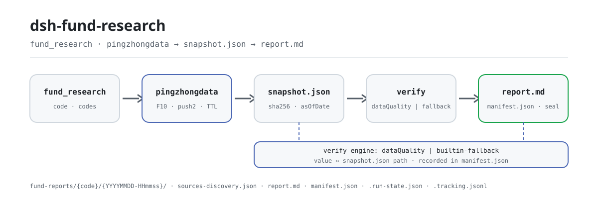

<div align="center">

<picture>
  <source media="(prefers-color-scheme: dark)" srcset="docs/assets/dsh-fund-research-flow-dark.svg">
  
</picture>

# dsh-fund-research

**Introduce un código de fondo de seis dígitos y obtén un informe de investigación sellado, con cada cifra trazable y cada hueco declarado.**

Plugin de investigación de fondos mutuos públicos chinos para DeepSeek Harness: recoge datos públicos de los endpoints de Tiantian Fund / Eastmoney con ritmo respetuoso, calcula todas las métricas de forma determinista en código y sella el informe junto con su instantánea fuente en tu espacio de trabajo — solo para investigación, no es asesoramiento de inversión.

[Instalar](#instalación-en-tres-pasos) · [Configuración](#configuración) · [FAQ](#faq) · [简体中文](README.md) · [English](README.en.md) · [Español](README.es.md) · [Português](README.pt.md) · [हिन्दी](README.hi.md)

[](LICENSE)
[](#compatibilidad)
[](https://www.npmjs.com/package/dsh-fund-research)
[](https://github.com/PerryLink/dsh-fund-research/actions/workflows/ci.yml)
[](#compatibilidad)

[](https://github.com/PerryLink/dsh-fund-research/stargazers)
[](https://www.npmjs.com/package/dsh-fund-research)
[](https://dshfind.com/plugins/PerryLink/dsh-fund-research?ref=badge)
[](https://securityscorecards.dev/viewer/?uri=github.com/PerryLink/dsh-fund-research)
[](https://dsh.market/)
[](https://gitee.com/perrylink/dsh-fund-research)

```sh
dsh plugin --profile <name> add dsh-fund-research
```

</div>

<sub>Plugin de la comunidad, no afiliado a DeepSeek. Repositorio canónico: <https://github.com/PerryLink/dsh-fund-research> (Gitee es un espejo).</sub>

## Qué es

Dale al modelo un código de fondo de seis dígitos y `dsh-fund-research` recoge los datos públicos de ese fondo, ejecuta un conjunto determinista de métricas, verifica cada cifra clave contra la instantánea fuente antes de sellar y escribe el informe —junto con la instantánea, el registro de adquisición y el manifiesto— en tu espacio de trabajo. Cada cifra del apéndice tiene su fila valor ↔ ruta JSON en la instantánea ↔ veredicto, así que puedes recalcularla desde `raw.*` con las convenciones documentadas y auditar el propio plugin. Cuando una fuente falla o se degrada, la sección afectada lleva una declaración explícita de hueco de datos; el plugin nunca rellena un hueco con una cifra inventada. Plugin solo de host: no opera, no predice, no es asesoramiento de inversión.

## Instalación en tres pasos

1. **Instalar** (elige un canal):

   ```sh
   # canal npm (versiones publicadas)
   dsh plugin --profile web add dsh-fund-research
   # canal git (última main)
   dsh plugin --profile web add github:PerryLink/dsh-fund-research
   # canal tarball: tras pnpm pack en este repositorio
   dsh plugin --profile web add ./dsh-fund-research-<version>.tgz
   ```

   Reinicia el perfil tras instalar (la activación del bundle es por reinicio). Los perfiles incluidos componen la pila de almacenamiento mediante `dsh-base` (`dsh-storage` + `dsh-storage-json` + `dsh-storage-domain`); el parche del bundle monta solo la fila del plugin. Un perfil desnudo debe componer la pila por su cuenta; de lo contrario el plugin no puede montarse.

2. **Configuración mínima** (los valores por defecto funcionan; ajusta la raíz del informe y la política de recogida si hace falta):

   ```yaml
   - insert:
       - id: dsh-fund-research
         name: dsh-fund-research
         config:
           offline: false
           reportRoot: fund-reports
           cacheTtlHours: 12
   ```

3. **Comprobar que funciona**: basta con pedírselo al agente; el plugin llama a `fund_research`:

   ```text
   > usa fund_research para generar un informe de investigación de 161725
   ```

   Al cabo de un momento el espacio de trabajo contiene un directorio versionado:

   ```text
   fund-reports/161725/20260819-153012/
   ├── snapshot.json            # datos extraídos + métricas calculadas + sha256 por fuente
   ├── sources-discovery.json   # lista de endpoints generada + cobertura + huecos
   ├── report.md                # informe con el apéndice de trazabilidad
   └── manifest.json            # hashes, parámetros, motor de verificación, huecos
   ```

**Desinstalar**: `dsh plugin --profile web remove dsh-fund-research` (o elimina la fila del parche del perfil).

### Ejemplos

Estos son los puntos de entrada reales del plugin; instala una vez y llama a uno.

**Ejemplo detallado** — comando:

```sh
fund_research({ code: "161725", sections: ["overview", "disclaimer"] })
```

Salida:

```text
招商中证白酒指数(LOF)A（161725）研究报告已封存 — 仅供研究参考，不构成投资建议
版本目录 20261019-124928；报告 fund-reports/161725/20261019-124928/report.md
manifest fund-reports/161725/20261019-124928/manifest.json（报告 sha256 f74b1446d544…）
数字回溯表核查（builtin-fallback）：verified 5 / mismatch 0 / not-found 0 / unverifiable 0
采集方式：快照复用（offline）；章节：overview、disclaimer
```

*Observed from `README.md:99-113,149-161; test/tools.spec.ts:150-171; src/tools/research.ts:121-130`*

**Rama de fallo** — entrada:

```text
{"code":"161725","asOfDate":"2024-02-30"}
```

Salida:

```text
isError=true; error.message=asOfDate must be a real calendar date, got "2024-02-30"
```

*Observed from `plugins/dsh-fund-research/src/sources/snapshot.ts:167 (parseAsOfDate); plugins/dsh-fund-research/README.md:173 (invalid dates fail loudly); exercised through plugins/dsh-fund-research/test/harness.ts`*

**Ejemplos breves**: `fund_snapshot`

## Capacidades clave

`dsh-fund-research` divide una investigación en cuatro etapas —recoger → calcular → verificar → sellar— y cada etapa deja un artefacto re-verificable:

- **Herramienta `fund_research`** — un código de fondo entra, un informe Markdown versionado sale: resumen, descomposición de rendimiento, penetración de posiciones, atribución de estilo simplificada, perfil del gestor, comparación con benchmark y pares, declaraciones de riesgo y huecos, descargo de responsabilidad y un **apéndice de trazabilidad numérica** que mapea cada cifra clave a su ruta JSON en la instantánea y su veredicto. Sellado en `fund-reports/{code}/{YYYYMMDD-HHmmss}/` como `report.md` + `manifest.json` + `snapshot.json`. `background: true` lo ejecuta como trabajo en segundo plano `fund-report`.
- **Herramienta `fund_snapshot`** — una tarjeta ligera (último NAV, rendimientos por etapa publicados, escala, gestor, 3 principales posiciones) sellada en el directorio del día del fondo.
- **Métricas deterministas, cero aritmética del modelo** — rendimiento por periodo/anualizado, volatilidad, drawdown máximo, Sharpe; concentración top-N, HHI, distribución sectorial, comparación trimestral de posiciones; bandas de estilo tamaño-valor; tenure del gestor y comparación con pares. Todo funciones puras sobre la instantánea sellada.
- **La trazabilidad es la función estrella** — antes del sellado, cada cifra clave se verifica contra el `snapshot.json` sellado a través del servicio opcional [`dsh-data-quality`](https://github.com/topics/dsh-plugin) cuando está instalado, o del verificador integrado isomorfo (`builtin-fallback`) en caso contrario. La tabla del apéndice registra valor ↔ ruta ↔ veredicto.
- **Huecos honestos** — una fuente fallida o degradada produce una declaración explícita de hueco de datos en la sección afectada. El plugin nunca rellena un hueco con una cifra inventada.
- **Modo offline** — `offline: true` (configuración o argumento de la herramienta) sirve todo desde la capa de instantáneas del dominio de almacenamiento o desde la instantánea más reciente en disco, sin ninguna petición saliente. Ideal para pruebas y reproducción.
- **Corte asOf** — `asOfDate` (ISO `YYYY-MM-DD`) trunca la serie de NAV a los datos hasta esa fecha inclusive y marca la instantánea y el informe con el corte; las fechas inválidas o futuras fallan de forma ruidosa.
- **Reanudación por checkpoint** — `<reportRoot>/.run-state.json` registra cada etapa (instantánea/informe) con marcas de tiempo y huella de entrada; `resume: true` continúa desde la primera etapa incompleta, reutiliza los artefactos sellados y rechaza una huella que no coincida.
- **Registro de descubrimiento de fuentes** — cada adquisición sella un `sources-discovery.json` generado por código (lista de endpoints, resolución primaria/de respaldo, cobertura y huecos por fuente, motivos de degradación) y lo integra en el apéndice como declaración de fuentes y huecos.
- **Fan-out multifondo** — `codes` acepta un array de códigos; cada fondo ejecuta su pipeline de forma independiente con aislamiento de fallos (los fallos pasan al resumen como huecos) y el resultado es una tarjeta resumen (code / asOf / hash del sello / veredictos / motivo del fallo).
- **Libro de seguimiento** — cada sellado correcto añade una línea determinista a `<reportRoot>/.tracking.jsonl`; `includeComparison: true` renderiza una sección determinista de comparación con la última ejecución (rango de NAV / escala / principales posiciones), con declaración de hueco cuando no hay registro previo.
- **Revisión de solo lectura** — tras sellar, un trabajo `fund-review` revisa los artefactos sellados (completitud de huecos, consistencia de la tabla de trazabilidad, descargo) y escribe `review-note.md`; se omite con elegancia (registrado en run-state) cuando no hay servicio de jobs.
- **Señales de calidad por fuente** — cada fuente lleva metadatos de calidad deterministas (`requested`/`succeeded`/`fieldsPresent`/`parseWarnings`/`degraded`), presentes en el apéndice y en los valores de la herramienta para que el consumidor pueda penalizar (nunca filtrar en duro) una fuente de baja calidad.
- **Resumen de estabilidad fuera de muestra** — `includeWalkForward: true` añade una sección de estabilidad fuera de muestra: persistencia de signo y media/desviación de rentabilidad/Sharpe en ventanas móviles deterministas, etiquetada explícitamente como descripción estadística, no como predicción.
- **Eventos de auditoría de sesión (según el host)** — los eventos solo-log `fund-research/snapshot` y `fund-research/report` llevan el código, el directorio de versión, el hash del manifiesto y la lista de huecos (visible para el modelo ⟺ registrado) *cuando el host admite tipos de evento externos al repositorio*; en hosts `0.1.2-alpha.1`–`0.1.5-alpha.1` el catálogo de tipos conocidos se genera en el build dentro del repositorio, así que la puerta no añade nada y los resultados de herramientas más los artefactos sellados son el rastro de auditoría.
- **Skill de metodología** — un skill `fund-research` incluido enseña al modelo las convenciones de métricas, el tratamiento de huecos y el lenguaje de cumplimiento; el cálculo se queda en el código.

### Herramientas y superficies

**Argumentos de `fund_research`**:

| Argumento | Tipo | Descripción |
|---|---|---|
| `code` | string | Código de fondo de seis dígitos, p. ej. `"161725"` (un fondo). Excluyente con `codes`. |
| `codes` | string[] | Varios códigos de seis dígitos: fan-out con aislamiento de fallos por fondo (devuelve un resumen). Excluyente con `code`. |
| `sections` | string[] | Secciones a renderizar (`overview`/`performance`/`holdings`/`style`/`manager`/`benchmark`/`risk`/`disclaimer`). Por defecto: todas. |
| `offline` | boolean | Solo leer la capa de instantáneas (sin red). Por defecto: configuración del plugin. |
| `asOfDate` | string | Fecha ISO 8601 (`YYYY-MM-DD`) de corte: solo se usan datos hasta esa fecha (serie de NAV truncada). Vacío = sin corte; fechas futuras fallan ruidosamente. |
| `resume` | boolean | Reanuda la ejecución registrada en `.run-state.json` desde la primera etapa incompleta (reutiliza artefactos sellados); rechaza huellas que no coincidan. Por defecto: `false`. |
| `includeComparison` | boolean | Renderiza una sección determinista de comparación con la última ejecución según el registro anterior de `.tracking.jsonl`; la evidencia ausente se declara como hueco. Por defecto: `false`. |
| `includeWalkForward` | boolean | Renderiza una sección determinista de estabilidad fuera de muestra (walk-forward): persistencia de signo y media/desviación en ventanas móviles. Solo descripción estadística, no predicción. Por defecto: `false`. |
| `background` | boolean | Ejecuta como trabajo en segundo plano `fund-report`; devuelve `{ kind: "background", jobId }`. Por defecto: `false`. |

**Argumentos de `fund_snapshot`**:

| Argumento | Tipo | Descripción |
|---|---|---|
| `code` (obligatorio) | string | Código de fondo de seis dígitos. |
| `offline` | boolean | Solo leer la capa de instantáneas. Por defecto: configuración del plugin. |
| `asOfDate` | string | Fecha ISO 8601 (`YYYY-MM-DD`) de corte: solo se usan datos hasta esa fecha. Vacío = sin corte; fechas futuras fallan ruidosamente. |

**Secciones del informe**: resumen · descomposición de rendimiento · penetración de posiciones · atribución de estilo (simplificada) · perfil del gestor · comparación con benchmark y pares · declaraciones de riesgo y huecos · descargo de responsabilidad · apéndice: tabla de trazabilidad. Cada cifra del apéndice de `report.md` lleva un veredicto `verified` / `mismatch` / `not-found` / `unverifiable` contra `snapshot.json`; cualquiera puede recalcularla desde `raw.*` con las convenciones documentadas y auditar el plugin.

## Configuración

Todas las claves son opcionales (se muestran los valores por defecto); los valores inválidos fallan ruidosamente al cargar. `cordis.patch.yml` documenta cada clave en línea.

Claves más usadas:

| Clave | Valor por defecto | Significado |
|---|---|---|
| `enabled` | `true` | Interruptor maestro; `false` no monta nada. |
| `promptSection` | `false` | Registra la breve declaración de rol de investigación de fondos en el system prompt de todo el despliegue. Apagado por defecto; `true` afecta a cada sesión del perfil. |
| `offline` | `false` | Nunca enviar peticiones; solo leer la capa de instantáneas. |
| `reportRoot` | `fund-reports` | Raíz del árbol de informes (relativa al espacio de trabajo o absoluta). |
| `cacheTtlHours` | `12` | Ventana de reutilización de instantáneas del dominio de almacenamiento. |
| `requestIntervalMs` | `1000` | Separación mínima entre peticiones salientes (recogida respetuosa). |
| `riskFreeRate` | `0.02` | Tasa libre de riesgo anual para el ratio de Sharpe. |

<details>
<summary>Tabla de configuración completa (14 claves)</summary>

| Clave | Valor por defecto | Significado |
|---|---|---|
| `enabled` | `true` | Interruptor maestro; `false` no monta nada. |
| `promptSection` | `false` | Registra la breve declaración de rol de investigación de fondos en el system prompt de todo el despliegue. Apagado por defecto; `true` afecta a cada sesión del perfil. |
| `eastmoneyBaseUrl` | `https://fund.eastmoney.com` | Host de pingzhongdata de Tiantian Fund. |
| `f10BaseUrl` | `https://fundf10.eastmoney.com` | Host F10 de Tiantian Fund (páginas de posiciones y gestor). |
| `quoteBaseUrl` | `https://push2.eastmoney.com` | Host de cotizaciones de Eastmoney para instantáneas de valoración por acción. |
| `quoteFallbackBaseUrl` | `https://push2delay.eastmoney.com` | Host de cotizaciones de respaldo por acción cuando falla el primario (host de cotización diferida de Eastmoney); `''` lo desactiva. |
| `requestIntervalMs` | `1000` | Separación mínima entre peticiones salientes (recogida respetuosa). |
| `timeoutMs` | `15000` | Tiempo de espera por petición. |
| `retries` | `2` | Reintentos por petición con backoff exponencial. |
| `cacheTtlHours` | `12` | Ventana de reutilización de instantáneas del dominio de almacenamiento. |
| `riskFreeRate` | `0.02` | Tasa libre de riesgo anual para el ratio de Sharpe. |
| `offline` | `false` | Nunca enviar peticiones; solo leer la capa de instantáneas. |
| `reportRoot` | `fund-reports` | Raíz del árbol de informes (relativa al espacio de trabajo o absoluta). |
| `styleQuotes` | `true` | Obtener cotizaciones de valoración por acción para la atribución de estilo. |

</details>

Ejemplo de override en el parche del perfil:

```yaml
- insert:
    - id: dsh-fund-research
      name: dsh-fund-research
      config:
        reportRoot: research/funds
        requestIntervalMs: 1500
        offline: false
```

## FAQ

<details>
<summary>¿Dónde viven el informe y la instantánea? ¿Una nueva ejecución sobrescribe la anterior?</summary>

Cada sellado correcto escribe un directorio de versión independiente `<reportRoot>/<code>/<YYYYMMDD-HHmmss>/` y nunca sobrescribe una versión anterior; `.tracking.jsonl` solo añade líneas y `.run-state.json` guarda el estado de reanudación. El dominio de almacenamiento `dsh_fund_research` conserva solo la instantánea más reciente por fondo (limitada por la ventana de reutilización `cacheTtlHours`). `reportRoot` puede ser una ruta relativa al espacio de trabajo o absoluta.

</details>

<details>
<summary>¿Qué pasa si una fuente cae o una página cambia? ¿Inventará cifras?</summary>

No. Los parsers son estrictos por diseño: cuando la estructura de una fuente deriva, lanza un `SourceParseError` que nombra el campo, y la sección afectada se degrada a una declaración explícita de hueco; si falla el bloque central de pingzhongdata, toda la ejecución falla ruidosamente. La verificación nunca bloquea el sellado: si el servicio opcional `dsh-data-quality` falta o falla, el plugin usa el verificador integrado `builtin-fallback`, y el motor realmente usado queda en el manifiesto y en el apéndice.

</details>

<details>
<summary>¿Compite con otros plugins por nombres de herramientas, servicios o eventos?</summary>

No. El plugin no registra ningún listener waterfall, ni slot de cliente, ni prefijo `webServer`; sus dos nombres de herramienta `fund_snapshot` / `fund_research` son independientes; los servicios opcionales (`jobs`, `skills`, `systemPrompt`, `dataQuality`) se leen vía `ctx.get` y se omiten o degradan si no existen en lugar de bloquear el montaje; el parche del bundle solo `insert`a su propia fila. El detalle punto por punto está en «Interoperabilidad con otros plugins DSH».

</details>

<details>
<summary>¿Cuánto tarda una investigación? ¿Cuál es el coste de rendimiento?</summary>

Una ejecución de `fund_research` es un número acotado de peticiones HTTP más cálculo de funciones puras más un sellado con hash. La salida se regula con `requestIntervalMs` (1000 ms por defecto), cada petición tiene `timeoutMs` de 15 s y `retries` 2; repetir el mismo fondo dentro de 12 horas puede reutilizar la instantánea (`cacheTtlHours`), y `offline: true` no hace ninguna petición y solo lee datos sellados. El cálculo son funciones puras: sin intervención del modelo y sin llamadas adicionales al modelo.

</details>

## Límites de seguridad

- Los códigos de fondo se validan como exactamente seis dígitos antes de tocar una ruta o una URL; la raíz del informe se resuelve dentro del espacio de trabajo de la sesión.
- Las cargas de las fuentes se hashean (SHA-256) al adquirirlas; el manifiesto sellado permite detectar ediciones silenciosas del upstream entre ejecuciones.
- La verificación nunca bloquea el sellado: un servicio opcional `dsh-data-quality` roto degrada al verificador integrado, y el motor usado queda registrado en el manifiesto y en el apéndice.
- Consulta [SECURITY.md](SECURITY.md) para la política de reporte.

## Permisos y datos

- **Lee** los endpoints públicos de Tiantian Fund / Eastmoney (`fund.eastmoney.com/pingzhongdata/*.js`, páginas F10 de `fundf10.eastmoney.com`, cotizaciones de `push2.eastmoney.com`) con User-Agent de navegador y ritmo respetuoso configurable. Sin clave, sin login, sin API de pago, sin eludir anti-bots.
- **Escribe** solo bajo la raíz de informes configurada dentro del espacio de trabajo de la sesión, más el dominio de almacenamiento `dsh_fund_research` (última instantánea por fondo).
- **Nunca** ejecuta JavaScript remoto (el bloque pingzhongdata se escanea, nunca se ejecuta), nunca guarda credenciales, nunca opera.
- Los eventos de sesión son registros de auditoría solo-log que pasan por una puerta adaptativa en `src/events.ts`: solo se añaden cuando el host admite un tipo externo al repositorio — su conjunto de tipos conocidos cubre el vocabulario, o su `Session.append` acepta un sobre `ignorable`. Desde `0.1.2-alpha.1` (incluido `0.1.5-alpha.1`) no se cumple ninguna: `KNOWN_SESSION_EVENT_TYPES` es un catálogo generado en el build dentro del repositorio que excluye por construcción los eventos externos, y `Session.append` no tiene opción `ignorable`, así que la puerta no añade nada — los resultados de herramientas y los artefactos sellados siguen siendo el rastro de auditoría reconstruible, y un fallo de append nunca cambia el resultado de una herramienta.
- 0.1.5-alpha.1 (adaptado 2026-09-09): puerta re-verificada en la nueva base — el catálogo sigue excluyendo eventos externos y `Session.append` sigue sin poder sellar un sobre `ignorable`, así que el comportamiento de la puerta no cambia.
- 0.1.5-rc.1 (adaptado 2026-09-10): los pins de dependencias pasan a la línea publicada 0.1.5-rc.1; ningún cambio de seam afecta al comportamiento del plugin.
- 0.1.5-rc.2 (adaptado 2026-09-11): los pins de dependencias pasan a la línea publicada 0.1.5-rc.2; ningún cambio de seam afecta al comportamiento del plugin.
- La declaración de rol de investigación de fondos es **opcional** (`promptSection: true`) y, al activarse, es de todo el despliegue: afecta a cada sesión del perfil que vea las herramientas de fondos, incluidas las que nunca las llamen.

## Limitaciones conocidas

- **Deriva de estructura del upstream.** Los parsers son estrictos por diseño: si Tiantian Fund cambia la forma de un `var Data_*` o el diseño de una tabla F10, la fuente afectada lanza un `SourceParseError` que nombra el campo, y la sección se degrada a un hueco declarado (si falla el bloque central de pingzhongdata, la ejecución aborta ruidosamente). Es deliberado: un parseo erróneo silencioso es peor que un hueco declarado.
- **La atribución de estilo es una convención de estimación.** Bandas fijas de tamaño (≥100 mil millones CNY / 30–100 mil millones CNY / <30 mil millones CNY) y bandas de PER, más quintiles dentro de las posiciones — no se consulta la distribución de todo el mercado. El informe lo etiqueta.
- **Las posiciones son datos de divulgación trimestral** (con retraso de divulgación); la página F10 trae los dos últimos trimestres.
- **Una llamada con `code` es un fondo; `codes` es un fan-out sobre varios fondos.** Sin análisis de cartera entre fondos, sin informes anuales PDF, sin cotizaciones en tiempo real (el endpoint en tiempo real `fundgz.1234567.com.cn` está muerto y no se usa a propósito).
- La fila de «deliverables» de la Web UI se activa con las tarjetas de llamada de herramientas mutadoras; los ficheros que produce este plugin aparecen en la ubicación de seguimiento de la tarjeta de llamada (el directorio del informe del fondo), no como filas por fichero.

## Interoperabilidad con otros plugins DSH

El plugin no registra ningún listener waterfall y no se apropia de la cadena de eventos de nadie; solo ofrece dos herramientas, una sección de prompt opcional, un proveedor de skills opcional y un dominio de almacenamiento. Punto por punto:

- **Sin colisión de nombres de herramienta.** Solo registra las herramientas con espacio de nombres `fund_snapshot` y `fund_research`, y ningún nombre desnudo de una herramienta integrada o de otro plugin.
- **Sin colisión de claves de servicio.** No ofrece ninguna clave de servicio; `jobs`, `skills`, `systemPrompt` y `dataQuality` son búsquedas `ctx.get` de solo lectura que se omiten en silencio si no existen.
- **Sin colisión de slots ni de rutas HTTP.** Plugin solo de host: sin slot de cliente, sin prefijo `webServer`.
- **Sin colisión de capa de parche.** El parche del bundle solo `insert`a su propia fila y nunca sobrescribe el `config` de una fila integrada.
- **La dependencia opcional es un contrato estructural.** `dsh-data-quality` se consume mediante una interfaz estructural local (`src/verify-bridge.ts`), nunca se importa; si el servicio falla, el plugin degrada al verificador integrado `builtin-fallback` y registra el motor en el manifiesto y el apéndice.
- **Aislamiento del dominio de almacenamiento.** Las instantáneas van a su propio dominio `dsh_fund_research`; la pila de almacenamiento la compone el perfil mediante `dsh-base`, y el plugin no la reemplaza ni la reescribe.
- **Sin ejecución de código remoto ni mutación global.** El bloque pingzhongdata se escanea, nunca se ejecuta; sin parcheo de prototipos, sin reescribir `process.env`, sin sustituir el fetch global.

## Compatibilidad

| Superficie | Estado |
|---|---|
| Harness | DeepSeek Harness `dsh-v0.2.1-rc.2` (el rango de peers admite la línea alpha.2: `>=0.1.2-rc.1 <0.2.0 \|\| >=0.1.5-alpha.1 <0.2.0 \|\| >=0.1.6-0 <0.2.0 \|\| >=0.1.7-0 <0.2.0`). En esta línea el tercer parámetro de `Session.append` es un `SurfaceIntent` solo para tipos de superficie, así que los eventos de auditoría `fund-research/*` siguen sin registrarse (los resultados de herramientas y el snapshot/informe sellado son el rastro de auditoría). Verificado el 2026-09-24 (doble typecheck + 176 pruebas). |
| Node | `^22.19.0 \|\| >=24.9.0` |
| Gestor de paquetes | `pnpm@11.7.0` |
| Plataformas | Windows / macOS / Linux (plugin solo de host) |
| Fuentes de datos | Endpoints públicos de Tiantian Fund / Eastmoney (sin clave, sin login) |

## Ecosistema y calidad

- [Espejo Gitee](https://gitee.com/perrylink/dsh-fund-research) (espejo sincronizado; GitHub es el canónico)
- [Página de dshfind](https://dshfind.com/plugins/PerryLink/dsh-fund-research) (instalaciones y ranking)
- [Informe OpenSSF Scorecard](https://securityscorecards.dev/viewer/?uri=github.com/PerryLink/dsh-fund-research) (impulsado por [.github/workflows/scorecard.yml](.github/workflows/scorecard.yml))
- [Informe de verificación de dsh-plugin-doctor](https://github.com/PerryLink/dsh-plugin-doctor#verified-徽章)
- [DSH Market](https://dsh.market/) (listado)
- **Canal 1024 store**: `npm i -g dsh1024` una vez, luego `dsh1024 plugin --profile web add dsh-fund-research` (cuenta para el ranking de instalaciones de [deepseek1024.com](https://deepseek1024.com))
- [Base de conocimiento del ecosistema](https://perrylink.github.io/dsh-plugin-guide/) — datos medidos, no marketing: guía de desarrollo · datos de selección · criterios de mantenimiento

## Desarrollo

```sh
pnpm install
pnpm run typecheck && pnpm run typecheck:ci && pnpm run typecheck:checkout   # tipos, incluida la regla CI-estricta
pnpm test                                     # 176 pruebas sobre seams reales del harness
pnpm run test:e2e                             # E2E opcional con red real (LIVE_E2E=1)
pnpm run build && pnpm run verify:artifacts   # tsdown + declaraciones tsc
pnpm run verify:self-contained                # sin specs de dependencia fuera del repositorio
node scripts/check-readme-sync.mjs            # puerta de READMEs en cinco idiomas
node scripts/check-endpoints.mjs              # sonda M3 de disponibilidad de endpoints (4 hosts de eastmoney)
pnpm pack                                     # tarball
```

Las pruebas usan el `Context`/`SessionStore`/`ToolRuntime`/`LocalJobRegistry`/seam de almacenamiento REALES de los peers 0.1.7-rc.2; la red se sustituye solo en la frontera fetch por fixtures de respuestas reales guardadas (`fixtures/`, fondo 161725). Refresca los fixtures con los scripts de recogida de `.tmp/`. Las imágenes del README las genera programáticamente [`scripts/gen-readme-assets.py`](scripts/gen-readme-assets.py) (Python + sonda de fuentes CJK, par SVG claro/oscuro) y se pueden volver a ejecutar.

Topics: `dsh`, `dsh-plugin`, `deepseek-harness`, `cordis`, `fund-research`, `mutual-fund`, `investment-research`, `finance`, `research-report`

## Familia y agradecimientos

Este proyecto forma parte de la familia de plugins de DeepSeek Harness de [PerryLink](https://github.com/PerryLink) (todos Apache-2.0). Si te resulta útil, **dale una estrella**: no desbloquea nada, pero ayuda a que la siguiente persona lo encuentre.

- **PerryLink** — mantenedor: el pipeline de recogida/métricas/sellado de informes, la sonda de disponibilidad de endpoints, CI y releases, y la documentación en cinco idiomas.
- **dsh-fund-research contributors** — autoría colectiva de la base (contrato de plugin, esquema de configuración, herramientas, pruebas, empaquetado).
- Aún no hay contribuidores externos — 0 PR/issue de la comunidad fusionados. Abre un issue con los formularios de `.github/ISSUE_TEMPLATE/` o un pull request contra `main` para aparecer aquí.

<details>
<summary>Expandir todos los plugins</summary>

| Plugin | Estado |
|---|---|
| **[dsh-aqua-input-check](https://github.com/PerryLink/dsh-aqua-input-check)** |  |
| **[dsh-archive-check](https://github.com/PerryLink/dsh-archive-check)** |  |
| **[dsh-auto-review](https://github.com/PerryLink/dsh-auto-review)** |  |
| **[dsh-autotier](https://github.com/PerryLink/dsh-autotier)** | 🧊 CONGELADO — ver el README del repo |
| **[dsh-bid-ca-precheck](https://github.com/PerryLink/dsh-bid-ca-precheck)** |  |
| **[dsh-bid-qual-check](https://github.com/PerryLink/dsh-bid-qual-check)** |  |
| **[dsh-cert-mcp](https://github.com/PerryLink/dsh-cert-mcp)** | 🧊 CONGELADO — ver el README del repo |
| **[dsh-checkpoint-rewind](https://github.com/PerryLink/dsh-checkpoint-rewind)** |  |
| **[dsh-click](https://github.com/PerryLink/dsh-click)** |  |
| **[dsh-composer-history](https://github.com/PerryLink/dsh-composer-history)** |  |
| **[dsh-contract-stance](https://github.com/PerryLink/dsh-contract-stance)** |  |
| **[dsh-customs-doc-check](https://github.com/PerryLink/dsh-customs-doc-check)** |  |
| **[dsh-data-quality](https://github.com/PerryLink/dsh-data-quality)** | 🧊 CONGELADO — ver el README del repo |
| **[dsh-demurrage-ledger](https://github.com/PerryLink/dsh-demurrage-ledger)** |  |
| **[dsh-doublecheck](https://github.com/PerryLink/dsh-doublecheck)** |  |
| **[dsh-drill-script-check](https://github.com/PerryLink/dsh-drill-script-check)** |  |
| **[dsh-eia-guide-check](https://github.com/PerryLink/dsh-eia-guide-check)** |  |
| **[dsh-emergency-plan](https://github.com/PerryLink/dsh-emergency-plan)** |  |
| **[dsh-essay-rubric-check](https://github.com/PerryLink/dsh-essay-rubric-check)** |  |
| **[dsh-evidence-check](https://github.com/PerryLink/dsh-evidence-check)** |  |
| **[dsh-export-ctl-check](https://github.com/PerryLink/dsh-export-ctl-check)** |  |
| **[dsh-fast](https://github.com/PerryLink/dsh-fast)** |  |
| **[dsh-fmea-table-check](https://github.com/PerryLink/dsh-fmea-table-check)** |  |
| **[dsh-forecast-penalty](https://github.com/PerryLink/dsh-forecast-penalty)** |  |
| **[dsh-fund-research](https://github.com/PerryLink/dsh-fund-research)** |  |
| **[dsh-github](https://github.com/PerryLink/dsh-github)** |  |
| **[dsh-gongwen-flow-check](https://github.com/PerryLink/dsh-gongwen-flow-check)** |  |
| **[dsh-gongwen-word-check](https://github.com/PerryLink/dsh-gongwen-word-check)** |  |
| **[dsh-guard-plan-qc](https://github.com/PerryLink/dsh-guard-plan-qc)** |  |
| **[dsh-hazchem-check](https://github.com/PerryLink/dsh-hazchem-check)** |  |
| **[dsh-hazplan-check](https://github.com/PerryLink/dsh-hazplan-check)** |  |
| **[dsh-hidden-risk-map](https://github.com/PerryLink/dsh-hidden-risk-map)** |  |
| **[dsh-hs-classify](https://github.com/PerryLink/dsh-hs-classify)** |  |
| **[dsh-icd-rule-check](https://github.com/PerryLink/dsh-icd-rule-check)** |  |
| **[dsh-industry-research](https://github.com/PerryLink/dsh-industry-research)** |  |
| **[dsh-lawcite-adapter](https://github.com/PerryLink/dsh-lawcite-adapter)** |  |
| **[dsh-laya](https://github.com/PerryLink/dsh-laya)** |  |
| **[dsh-lc-doc-check](https://github.com/PerryLink/dsh-lc-doc-check)** |  |
| **[dsh-learning-gap-check](https://github.com/PerryLink/dsh-learning-gap-check)** |  |
| **[dsh-library](https://github.com/PerryLink/dsh-library)** |  |
| **[dsh-local-ai](https://github.com/PerryLink/dsh-local-ai)** |  |
| **[dsh-lsp-actions](https://github.com/PerryLink/dsh-lsp-actions)** |  |
| **[dsh-mask](https://github.com/PerryLink/dsh-mask)** |  |
| **[dsh-mcp-panel](https://github.com/PerryLink/dsh-mcp-panel)** |  |
| **[dsh-medrec-qc](https://github.com/PerryLink/dsh-medrec-qc)** |  |
| **[dsh-memento](https://github.com/PerryLink/dsh-memento)** | 🧊 CONGELADO — ver el README del repo |
| **[dsh-nsfc-form-check](https://github.com/PerryLink/dsh-nsfc-form-check)** |  |
| **[dsh-nurse-record-check](https://github.com/PerryLink/dsh-nurse-record-check)** |  |
| **[dsh-observe](https://github.com/PerryLink/dsh-observe)** |  |
| **[dsh-origin-rvc-check](https://github.com/PerryLink/dsh-origin-rvc-check)** |  |
| **[dsh-ota-review-check](https://github.com/PerryLink/dsh-ota-review-check)** |  |
| **[dsh-output-styles](https://github.com/PerryLink/dsh-output-styles)** |  |
| **[dsh-paper-doc-adapter](https://github.com/PerryLink/dsh-paper-doc-adapter)** |  |
| **[dsh-permission-rules](https://github.com/PerryLink/dsh-permission-rules)** |  |
| **[dsh-permit-report-check](https://github.com/PerryLink/dsh-permit-report-check)** |  |
| **[dsh-pipeline-check](https://github.com/PerryLink/dsh-pipeline-check)** |  |
| **[dsh-pleading-draft](https://github.com/PerryLink/dsh-pleading-draft)** |  |
| **[dsh-plugin-doctor](https://github.com/PerryLink/dsh-plugin-doctor)** | 🚫 RETIRADO (repo archivado) |
| **[dsh-plugin-guide](https://github.com/PerryLink/dsh-plugin-guide)** |  |
| **[dsh-plugin-kit](https://github.com/PerryLink/dsh-plugin-kit)** | 🚫 RETIRADO (repo archivado) |
| **[dsh-plugin-upgrade](https://github.com/PerryLink/dsh-plugin-upgrade)** | 🚫 RETIRADO (repo archivado) |
| **[dsh-policy-brief-draft](https://github.com/PerryLink/dsh-policy-brief-draft)** |  |
| **[dsh-power-loss-split](https://github.com/PerryLink/dsh-power-loss-split)** |  |
| **[dsh-power-ticket-check](https://github.com/PerryLink/dsh-power-ticket-check)** |  |
| **[dsh-ppap-check](https://github.com/PerryLink/dsh-ppap-check)** |  |
| **[dsh-protest-deadline](https://github.com/PerryLink/dsh-protest-deadline)** |  |
| **[dsh-railway-window](https://github.com/PerryLink/dsh-railway-window)** |  |
| **[dsh-repair-order-qc](https://github.com/PerryLink/dsh-repair-order-qc)** |  |
| **[dsh-research-report](https://github.com/PerryLink/dsh-research-report)** |  |
| **[dsh-review-reply-check](https://github.com/PerryLink/dsh-review-reply-check)** |  |
| **[dsh-rulefile-check](https://github.com/PerryLink/dsh-rulefile-check)** |  |
| **[dsh-safety-brief-check](https://github.com/PerryLink/dsh-safety-brief-check)** |  |
| **[dsh-score](https://github.com/PerryLink/dsh-score)** | 🧊 CONGELADO — ver el README del repo |
| **[dsh-session-sync](https://github.com/PerryLink/dsh-session-sync)** |  |
| **[dsh-site-log-check](https://github.com/PerryLink/dsh-site-log-check)** |  |
| **[dsh-skill-pack-security](https://github.com/PerryLink/dsh-skill-pack-security)** |  |
| **[dsh-soe-decision-check](https://github.com/PerryLink/dsh-soe-decision-check)** |  |
| **[dsh-soilwater-check](https://github.com/PerryLink/dsh-soilwater-check)** |  |
| **[dsh-sop-sync-check](https://github.com/PerryLink/dsh-sop-sync-check)** |  |
| **[dsh-spc-gbt-adapter](https://github.com/PerryLink/dsh-spc-gbt-adapter)** |  |
| **[dsh-talk](https://github.com/PerryLink/dsh-talk)** |  |
| **[dsh-tender-extract](https://github.com/PerryLink/dsh-tender-extract)** |  |
| **[dsh-tender-matrix](https://github.com/PerryLink/dsh-tender-matrix)** |  |
| **[dsh-test-drive](https://github.com/PerryLink/dsh-test-drive)** |  |
| **[dsh-ticktick](https://github.com/PerryLink/dsh-ticktick)** | 🚫 RETIRADO (repo archivado) |
| **[dsh-translate](https://github.com/PerryLink/dsh-translate)** |  |
| **[dsh-warranty-calc](https://github.com/PerryLink/dsh-warranty-calc)** |  |
| **[dsh-budget](https://github.com/PerryLink/dsh-budget)** | 🧊 CONGELADO — ver el README del repo |
| **[dsh-claude-move](https://github.com/PerryLink/dsh-claude-move)** | 🧊 CONGELADO — ver el README del repo |
| **[dsh-defend](https://github.com/PerryLink/dsh-defend)** | 🧊 CONGELADO — ver el README del repo |
| **[dsh-draw](https://github.com/PerryLink/dsh-draw)** | 🧊 CONGELADO — ver el README del repo |
| **[dsh-reach](https://github.com/PerryLink/dsh-reach)** | 🧊 CONGELADO — ver el README del repo |
| **[dsh-background-agents](https://github.com/PerryLink/dsh-background-agents)** | 🚫 RETIRADO (repo archivado) |
| **[dsh-session-pin](https://github.com/PerryLink/dsh-session-pin)** | 🚫 RETIRADO (repo archivado) |
| **[dsh-team-rooms](https://github.com/PerryLink/dsh-team-rooms)** | 🚫 RETIRADO (repo archivado) |

</details>

## Licencia

[LICENSE](LICENSE) (Apache License 2.0) © 2026 dsh-fund-research contributors

<p align="center"><sub>Apache-2.0 · Plugin de la comunidad, no afiliado a DeepSeek.</sub></p>
