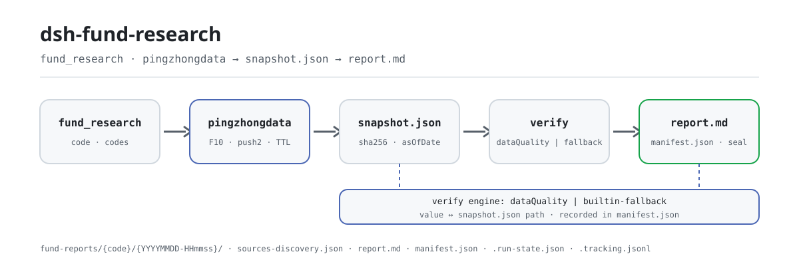

<div align="center">

<picture>
  <source media="(prefers-color-scheme: dark)" srcset="docs/assets/dsh-fund-research-flow-dark.svg">
  
</picture>

# dsh-fund-research

**छह अंकों का फंड कोड दें और ऐसी सील्ड रिसर्च रिपोर्ट पाएँ जिसका हर आँकड़ा ट्रेस करने योग्य हो और हर गैप स्पष्ट रूप से घोषित हो।**

DeepSeek Harness के लिए चीनी सार्वजनिक म्यूचुअल फंड रिसर्च प्लगइन: यह Tiantian Fund / Eastmoney के सार्वजनिक एंडपॉइंट से विनम्र गति से डेटा इकट्ठा करता है, हर मीट्रिक की गणना कोड में निश्चित रूप से करता है, और रिपोर्ट को उसके स्रोत स्नैपशॉट के साथ आपके वर्कस्पेस में सील कर देता है — केवल रिसर्च के लिए, निवेश सलाह नहीं।

[इंस्टॉल](#तीन-चरणों-में-शुरुआत) · [कॉन्फ़िगरेशन](#कॉन्फ़िगरेशन) · [FAQ](#faq) · [简体中文](README.md) · [English](README.en.md) · [Español](README.es.md) · [Português](README.pt.md) · [हिन्दी](README.hi.md)

[](LICENSE)
[](#संगतता)
[](https://www.npmjs.com/package/dsh-fund-research)
[](https://github.com/PerryLink/dsh-fund-research/actions/workflows/ci.yml)
[](#संगतता)

[](https://github.com/PerryLink/dsh-fund-research/stargazers)
[](https://www.npmjs.com/package/dsh-fund-research)
[](https://dshfind.com/plugins/PerryLink/dsh-fund-research?ref=badge)
[](https://securityscorecards.dev/viewer/?uri=github.com/PerryLink/dsh-fund-research)
[](https://dsh.market/)
[](https://gitee.com/perrylink/dsh-fund-research)

```sh
dsh plugin --profile <name> add dsh-fund-research
```

</div>

<sub>सामुदायिक प्लगइन, DeepSeek से असंबद्ध। कैनोनिकल रिपॉज़िटरी: <https://github.com/PerryLink/dsh-fund-research> (Gitee एक मिरर है)।</sub>

## यह क्या है

मॉडल को छह अंकों का फंड कोड दें और `dsh-fund-research` उस फंड का सार्वजनिक डेटा इकट्ठा करता है, मीट्रिक्स का निश्चित सेट चलाता है, सील करने से पहले हर प्रमुख आँकड़े को स्रोत स्नैपशॉट के सामने जाँचता है, और फिर रिपोर्ट को स्नैपशॉट, अधिग्रहण रिकॉर्ड और मैनिफ़ेस्ट के साथ आपके वर्कस्पेस में लिखता है। रिपोर्ट के परिशिष्ट में हर आँकड़े की एक पंक्ति होती है: मान ↔ स्नैपशॉट JSON पथ ↔ निर्णय, इसलिए आप दस्तावेज़ीकृत परिपाटियों से `raw.*` के आधार पर इसे दोबारा गणना कर सकते हैं और प्लगइन का ही ऑडिट कर सकते हैं। जब कोई डेटा स्रोत विफल या कमज़ोर होता है, प्रभावित अनुभाग में स्पष्ट डेटा-गैप घोषणा आती है; प्लगइन कभी भी गढ़े हुए आँकड़े से गैप नहीं भरता। केवल-होस्ट प्लगइन: कोई ट्रेडिंग नहीं, कोई भविष्यवाणी नहीं, निवेश सलाह नहीं।

## तीन चरणों में शुरुआत

1. **इंस्टॉल करें** (कोई एक चैनल चुनें):

   ```sh
   # npm चैनल (प्रकाशित संस्करण)
   dsh plugin --profile web add dsh-fund-research
   # git चैनल (नवीनतम main)
   dsh plugin --profile web add github:PerryLink/dsh-fund-research
   # tarball चैनल: इस रेपो में pnpm pack के बाद
   dsh plugin --profile web add ./dsh-fund-research-<version>.tgz
   ```

   इंस्टॉल के बाद प्रोफ़ाइल रीस्टार्ट करें (bundle सक्रियण रीस्टार्ट-आधारित है)। शिप्ड प्रोफ़ाइल `dsh-base` के ज़रिए स्टोरेज स्टैक (`dsh-storage` + `dsh-storage-json` + `dsh-storage-domain`) जोड़ते हैं; bundle patch केवल प्लगइन की पंक्ति माउंट करता है। खाली प्रोफ़ाइल को स्टोरेज स्टैक स्वयं जोड़ना होगा, वरना प्लगइन माउंट नहीं हो सकता।

2. **न्यूनतम कॉन्फ़िगरेशन** (डिफ़ॉल्ट काम करते हैं; रिपोर्ट रूट और संग्रह नीति ज़रूरत के अनुसार बदलें):

   ```yaml
   - insert:
       - id: dsh-fund-research
         name: dsh-fund-research
         config:
           offline: false
           reportRoot: fund-reports
           cacheTtlHours: 12
   ```

3. **जाँचें कि काम कर रहा है**: एजेंट से बस कहें; प्लगइन `fund_research` कॉल करेगा:

   ```text
   > fund_research से 161725 की रिसर्च रिपोर्ट बनाओ
   ```

   कुछ ही देर में वर्कस्पेस में संस्करणित डायरेक्टरी मिलती है:

   ```text
   fund-reports/161725/20260819-153012/
   ├── snapshot.json            # कच्चा डेटा + परिकलित मीट्रिक्स + प्रति-स्रोत sha256
   ├── sources-discovery.json   # कोड-जनित एंडपॉइंट सूची + कवरेज + गैप
   ├── report.md                # ट्रेसबिलिटी परिशिष्ट वाली रिपोर्ट
   └── manifest.json            # हैश, पैरामीटर, सत्यापन इंजन, गैप
   ```

**अनइंस्टॉल**: `dsh plugin --profile web remove dsh-fund-research` (या प्रोफ़ाइल patch से पंक्ति हटाएँ)।

### उदाहरण

ये प्लगइन के वास्तविक एंट्री पॉइंट हैं; एक बार इंस्टॉल करें, फिर कोई एक कॉल करें।

**विस्तृत उदाहरण** — कमांड:

```sh
fund_research({ code: "161725", sections: ["overview", "disclaimer"] })
```

आउटपुट:

```text
招商中证白酒指数(LOF)A（161725）研究报告已封存 — 仅供研究参考，不构成投资建议
版本目录 20261019-124928；报告 fund-reports/161725/20261019-124928/report.md
manifest fund-reports/161725/20261019-124928/manifest.json（报告 sha256 f74b1446d544…）
数字回溯表核查（builtin-fallback）：verified 5 / mismatch 0 / not-found 0 / unverifiable 0
采集方式：快照复用（offline）；章节：overview、disclaimer
```

*Observed from `README.md:99-113,149-161; test/tools.spec.ts:150-171; src/tools/research.ts:121-130`*

**विफलता शाखा** — इनपुट:

```text
{"code":"161725","asOfDate":"2024-02-30"}
```

आउटपुट:

```text
isError=true; error.message=asOfDate must be a real calendar date, got "2024-02-30"
```

*Observed from `plugins/dsh-fund-research/src/sources/snapshot.ts:167 (parseAsOfDate); plugins/dsh-fund-research/README.md:173 (invalid dates fail loudly); exercised through plugins/dsh-fund-research/test/harness.ts`*

**संक्षिप्त उदाहरण**: `fund_snapshot`

## मुख्य क्षमताएँ

`dsh-fund-research` एक रिसर्च को चार चरणों में बाँटता है — इकट्ठा → गणना → सत्यापन → सील — और हर चरण पुनः-जाँचने योग्य आर्टिफ़ैक्ट छोड़ता है:

- **`fund_research` टूल** — एक फंड कोड अंदर, संस्करणित Markdown रिपोर्ट बाहर: अवलोकन, प्रदर्शन विश्लेषण, होल्डिंग्स पैठ, सरलीकृत स्टाइल एट्रिब्यूशन, मैनेजर प्रोफ़ाइल, बेंचमार्क और पीयर तुलना, जोखिम व गैप घोषणाएँ, अस्वीकरण, और **संख्या-ट्रेसबिलिटी परिशिष्ट** जो हर प्रमुख आँकड़े को स्नैपशॉट JSON पथ और सत्यापन निर्णय से जोड़ता है। `fund-reports/{code}/{YYYYMMDD-HHmmss}/` में `report.md` + `manifest.json` + `snapshot.json` के रूप में सील। `background: true` इसे `fund-report` बैकग्राउंड जॉब के रूप में चलाता है।
- **`fund_snapshot` टूल** — हल्का स्नैपशॉट कार्ड (नवीनतम NAV, प्रकाशित चरण रिटर्न, स्केल, मैनेजर, शीर्ष-3 होल्डिंग्स) जो फंड की उस दिन की डायरेक्टरी में सील होता है।
- **निश्चित मीट्रिक्स, शून्य मॉडल-गणित** — अवधि/वार्षिक रिटर्न, वोलैटिलिटी, अधिकतम ड्रॉडाउन, Sharpe; शीर्ष-N संकेंद्रण, HHI, उद्योग वितरण, तिमाही-दर-तिमाही होल्डिंग्स तुलना; आकार-मूल्य स्टाइल बैंड; मैनेजर कार्यकाल और पीयर तुलना। सब सील्ड स्नैपशॉट पर शुद्ध फ़ंक्शन।
- **ट्रेसबिलिटी पहली श्रेणी की सुविधा** — सील से पहले हर प्रमुख आँकड़ा सील्ड `snapshot.json` के सामने जाँचा जाता है: वैकल्पिक [`dsh-data-quality`](https://github.com/topics/dsh-plugin) सेवा इंस्टॉल हो तो उसके ज़रिए, वरना अंतर्निहित समरूपी फ़ॉलबैक जाँचकर्ता (`builtin-fallback`) के ज़रिए। परिशिष्ट तालिका मान ↔ पथ ↔ निर्णय दर्ज करती है।
- **ईमानदार गैप** — विफल या कमज़ोर डेटा स्रोत प्रभावित अनुभाग में स्पष्ट डेटा-गैप घोषणा देता है। प्लगइन कभी गढ़े हुए आँकड़े से गैप नहीं भरता।
- **ऑफ़लाइन मोड** — `offline: true` (कॉन्फ़िगरेशन या टूल आर्ग्युमेंट) में सब कुछ स्टोरेज-डोमेन स्नैपशॉट परत या डिस्क के नवीनतम संस्करण स्नैपशॉट से पढ़ा जाता है, शून्य आउटबाउंड अनुरोध। टेस्ट और पुनरुत्पादन के लिए उपयुक्त।
- **asOf कटऑफ़** — `asOfDate` (ISO `YYYY-MM-DD`) NAV श्रृंखला को उस तारीख (सम्मिलित) तक काटता है और स्नैपशॉट व रिपोर्ट पर कटऑफ़ अंकित करता है; अमान्य या भविष्य की तारीखें ज़ोरदार ढंग से विफल होती हैं।
- **चेकपॉइंट रिज़्यूम** — `<reportRoot>/.run-state.json` हर चरण (स्नैपशॉट/रिपोर्ट) को समय-चिह्न और इनपुट फ़िंगरप्रिंट के साथ दर्ज करता है; `resume: true` पहले अपूर्ण चरण से आगे बढ़ता है, सील्ड आर्टिफ़ैक्ट पुनः उपयोग करता है, और फ़िंगरप्रिंट मेल न खाने पर मना कर देता है।
- **स्रोत-खोज रिकॉर्ड** — हर अधिग्रहण कोड-जनित `sources-discovery.json` सील करता है (एंडपॉइंट सूची, प्राथमिक/फ़ॉलबैक समाधान, प्रति-स्रोत कवरेज और गैप, कमज़ोरी के कारण) और उसे रिपोर्ट परिशिष्ट में डेटा-स्रोत व गैप घोषणा के रूप में जोड़ता है।
- **मल्टी-फंड फैन-आउट** — `codes` फंड कोड की सरणी लेता है; हर फंड अपनी पाइपलाइन स्वतंत्र रूप से चलाता है, प्रति-फंड विफलता अलगाव के साथ (विफलताएँ सारांश गैप बनती हैं), और परिणाम एक सारांश कार्ड होता है (code / asOf / seal हैश / निर्णय / विफलता कारण)।
- **ट्रैकिंग लेजर** — हर सफल सील `<reportRoot>/.tracking.jsonl` में एक निश्चित पंक्ति जोड़ती है; `includeComparison: true` पिछली प्रविष्टि के सामने निश्चित "पिछली बार से तुलना" अनुभाग बनाता है (NAV रेंज / स्केल / शीर्ष होल्डिंग्स), और पिछला रिकॉर्ड न होने पर गैप घोषित करता है।
- **रीड-ओनली समीक्षा** — सील के बाद `fund-review` जॉब सील्ड आर्टिफ़ैक्ट की समीक्षा करता है (गैप घोषणाओं की पूर्णता, ट्रेसबिलिटी तालिका की संगति, अस्वीकरण) और `review-note.md` लिखता है; jobs सेवा न होने पर शालीनता से छोड़ देता है (run-state में दर्ज)।
- **प्रति-स्रोत गुणवत्ता संकेत** — हर स्रोत निश्चित गुणवत्ता मेटाडेटा रखता है (`requested`/`succeeded`/`fieldsPresent`/`parseWarnings`/`degraded`), जो परिशिष्ट में दिखता है और टूल मानों में आता है ताकि डाउनस्ट्रीम कमज़ोर स्रोत को कम भार दे सके (कठोर फ़िल्टर कभी नहीं)।
- **वॉक-फ़ॉरवर्ड स्थिरता सारांश** — `includeWalkForward: true` आउट-ऑफ़-सैंपल स्थिरता अनुभाग जोड़ता है: निश्चित रोलिंग-विंडो रिटर्न/Sharpe चिह्न निरंतरता और माध्य/मानक विचलन, स्पष्ट रूप से केवल सांख्यिकीय विवरण, भविष्यवाणी नहीं।
- **सत्र ऑडिट इवेंट (होस्ट पर निर्भर)** — `fund-research/snapshot` और `fund-research/report` केवल-लॉग इवेंट कोड, संस्करण डायरेक्टरी, मैनिफ़ेस्ट हैश और गैप सूची ले जाते हैं (मॉडल-दृश्य ⟺ लॉग) *जब होस्ट रेपो-बाहरी इवेंट प्रकार स्वीकार करता है*; `0.1.2-alpha.1`–`0.1.5-alpha.1` होस्ट पर ज्ञात-प्रकार सूची बिल्ड में रेपो के भीतर बनती है, इसलिए गेट कुछ नहीं जोड़ता और टूल परिणाम व सील्ड आर्टिफ़ैक्ट ही ऑडिट ट्रेल हैं।
- **पद्धति skill** — बंडल किया गया `fund-research` skill मॉडल को मीट्रिक परिपाटियाँ, गैप प्रबंधन और अनुपालन भाषा सिखाता है; गणना कोड में ही रहती है।

### टूल और सतहें

**`fund_research` आर्ग्युमेंट**:

| आर्ग्युमेंट | प्रकार | विवरण |
|---|---|---|
| `code` | string | छह अंकों का फंड कोड, जैसे `"161725"` (एक फंड)। `codes` के साथ परस्पर अनन्य। |
| `codes` | string[] | कई छह-अंकीय फंड कोड: प्रति-फंड विफलता अलगाव के साथ फैन-आउट (सारांश लौटाता है)। `code` के साथ परस्पर अनन्य। |
| `sections` | string[] | रेंडर करने के अनुभाग (`overview`/`performance`/`holdings`/`style`/`manager`/`benchmark`/`risk`/`disclaimer`)। डिफ़ॉल्ट: सभी। |
| `offline` | boolean | केवल स्नैपशॉट परत पढ़ें (नेटवर्क नहीं)। डिफ़ॉल्ट: प्लगइन कॉन्फ़िगरेशन। |
| `asOfDate` | string | ISO 8601 तारीख (`YYYY-MM-DD`) कटऑफ़: केवल उस तारीख तक के डेटा का उपयोग (NAV श्रृंखला कटी)। खाली = कोई कटऑफ़ नहीं; भविष्य की तारीखें ज़ोरदार विफल। |
| `resume` | boolean | `.run-state.json` में दर्ज रन को पहले अपूर्ण चरण से फिर शुरू करें (सील्ड आर्टिफ़ैक्ट पुनः उपयोग); फ़िंगरप्रिंट मेल न खाए तो मना। डिफ़ॉल्ट: `false`। |
| `includeComparison` | boolean | पिछली `.tracking.jsonl` प्रविष्टि के सामने निश्चित तुलना अनुभाग रेंडर करें; अनुपलब्ध साक्ष्य गैप के रूप में घोषित। डिफ़ॉल्ट: `false`। |
| `includeWalkForward` | boolean | निश्चित आउट-ऑफ़-सैंपल स्थिरता सारांश (वॉक-फ़ॉरवर्ड) रेंडर करें: रोलिंग-विंडो रिटर्न/Sharpe चिह्न निरंतरता और माध्य/मानक विचलन। केवल सांख्यिकीय विवरण, भविष्यवाणी नहीं। डिफ़ॉल्ट: `false`। |
| `background` | boolean | `fund-report` बैकग्राउंड जॉब के रूप में चलाएँ; `{ kind: "background", jobId }` लौटाता है। डिफ़ॉल्ट: `false`। |

**`fund_snapshot` आर्ग्युमेंट**:

| आर्ग्युमेंट | प्रकार | विवरण |
|---|---|---|
| `code` (आवश्यक) | string | छह अंकों का फंड कोड। |
| `offline` | boolean | केवल स्नैपशॉट परत पढ़ें। डिफ़ॉल्ट: प्लगइन कॉन्फ़िगरेशन। |
| `asOfDate` | string | ISO 8601 तारीख (`YYYY-MM-DD`) कटऑफ़: केवल उस तारीख तक के डेटा का उपयोग। खाली = कोई कटऑफ़ नहीं; भविष्य की तारीखें ज़ोरदार विफल। |

**रिपोर्ट अनुभाग**: अवलोकन · प्रदर्शन विश्लेषण · होल्डिंग्स पैठ · स्टाइल एट्रिब्यूशन (सरलीकृत) · मैनेजर प्रोफ़ाइल · बेंचमार्क व पीयर तुलना · जोखिम व गैप घोषणाएँ · अस्वीकरण · परिशिष्ट: ट्रेसबिलिटी तालिका। `report.md` के परिशिष्ट में हर आँकड़े के साथ `snapshot.json` के सामने `verified` / `mismatch` / `not-found` / `unverifiable` निर्णय होता है; कोई भी दस्तावेज़ीकृत परिपाटियों से `raw.*` के आधार पर उसे दोबारा गणना कर प्लगइन का ऑडिट कर सकता है।

## कॉन्फ़िगरेशन

सभी कुंजियाँ वैकल्पिक हैं (डिफ़ॉल्ट दिखाए गए हैं); अमान्य मान लोड पर ज़ोरदार विफल होते हैं। `cordis.patch.yml` हर कुंजी को इनलाइन टिप्पणी से समझाता है।

सबसे अधिक उपयोग होने वाली कुंजियाँ:

| कुंजी | डिफ़ॉल्ट | अर्थ |
|---|---|---|
| `enabled` | `true` | मास्टर स्विच; `false` पर कुछ भी माउंट नहीं होता। |
| `promptSection` | `false` | संक्षिप्त फंड-रिसर्च भूमिका वक्तव्य को पूरे डिप्लॉयमेंट के system prompt में पंजीकृत करता है। डिफ़ॉल्ट बंद; `true` प्रोफ़ाइल के हर सत्र पर लागू होता है। |
| `offline` | `false` | कभी अनुरोध न भेजें; केवल स्नैपशॉट परत पढ़ें। |
| `reportRoot` | `fund-reports` | रिपोर्ट ट्री का रूट (वर्कस्पेस-सापेक्ष या निरपेक्ष)। |
| `cacheTtlHours` | `12` | स्टोरेज-डोमेन स्नैपशॉट पुनः उपयोग विंडो। |
| `requestIntervalMs` | `1000` | आउटबाउंड अनुरोधों के बीच न्यूनतम अंतराल (विनम्र संग्रह)। |
| `riskFreeRate` | `0.02` | Sharpe अनुपात के लिए वार्षिक जोखिम-मुक्त दर। |

<details>
<summary>पूर्ण कॉन्फ़िगरेशन तालिका (14 कुंजियाँ)</summary>

| कुंजी | डिफ़ॉल्ट | अर्थ |
|---|---|---|
| `enabled` | `true` | मास्टर स्विच; `false` पर कुछ भी माउंट नहीं होता। |
| `promptSection` | `false` | संक्षिप्त फंड-रिसर्च भूमिका वक्तव्य को पूरे डिप्लॉयमेंट के system prompt में पंजीकृत करता है। डिफ़ॉल्ट बंद; `true` प्रोफ़ाइल के हर सत्र पर लागू होता है। |
| `eastmoneyBaseUrl` | `https://fund.eastmoney.com` | Tiantian Fund pingzhongdata होस्ट। |
| `f10BaseUrl` | `https://fundf10.eastmoney.com` | Tiantian Fund F10 होस्ट (होल्डिंग्स + मैनेजर पेज)। |
| `quoteBaseUrl` | `https://push2.eastmoney.com` | प्रति-स्टॉक वैल्यूएशन स्नैपशॉट के लिए Eastmoney कोट होस्ट। |
| `quoteFallbackBaseUrl` | `https://push2delay.eastmoney.com` | प्राथमिक विफल होने पर प्रति-स्टॉक आज़माया जाने वाला फ़ॉलबैक कोट होस्ट (Eastmoney का अपना विलंबित-कोट होस्ट); `''` इसे बंद करता है। |
| `requestIntervalMs` | `1000` | आउटबाउंड अनुरोधों के बीच न्यूनतम अंतराल (विनम्र संग्रह)। |
| `timeoutMs` | `15000` | प्रति-अनुरोध टाइमआउट। |
| `retries` | `2` | प्रति-अनुरोध पुनः प्रयास, एक्सपोनेंशियल बैकऑफ़ के साथ। |
| `cacheTtlHours` | `12` | स्टोरेज-डोमेन स्नैपशॉट पुनः उपयोग विंडो। |
| `riskFreeRate` | `0.02` | Sharpe अनुपात के लिए वार्षिक जोखिम-मुक्त दर। |
| `offline` | `false` | कभी अनुरोध न भेजें; केवल स्नैपशॉट परत पढ़ें। |
| `reportRoot` | `fund-reports` | रिपोर्ट ट्री का रूट (वर्कस्पेस-सापेक्ष या निरपेक्ष)। |
| `styleQuotes` | `true` | स्टाइल एट्रिब्यूशन के लिए प्रति-स्टॉक वैल्यूएशन कोट लाएँ। |

</details>

प्रोफ़ाइल patch में ओवरराइड का उदाहरण:

```yaml
- insert:
    - id: dsh-fund-research
      name: dsh-fund-research
      config:
        reportRoot: research/funds
        requestIntervalMs: 1500
        offline: false
```

## FAQ

<details>
<summary>रिपोर्ट और स्नैपशॉट कहाँ रहते हैं? क्या नया रन पिछले को मिटा देता है?</summary>

हर सफल सील एक स्वतंत्र संस्करण डायरेक्टरी `<reportRoot>/<code>/<YYYYMMDD-HHmmss>/` में लिखी जाती है और पुराना संस्करण कभी नहीं मिटाया जाता; `.tracking.jsonl` केवल जोड़ता है, और `.run-state.json` रिज़्यूम स्थिति रखता है। `dsh_fund_research` स्टोरेज डोमेन प्रति फंड केवल नवीनतम स्नैपशॉट रखता है (`cacheTtlHours` पुनः उपयोग विंडो से सीमित)। `reportRoot` वर्कस्पेस-सापेक्ष या निरपेक्ष पथ हो सकता है।

</details>

<details>
<summary>डेटा स्रोत बंद हो जाए या पेज बदल जाए तो क्या होगा? क्या आँकड़े गढ़े जाएँगे?</summary>

नहीं। पार्सर जानबूझकर सख्त हैं: किसी स्रोत की संरचना बदलने पर वह फ़ील्ड का नाम लेते हुए `SourceParseError` फेंकता है, और प्रभावित अनुभाग स्पष्ट डेटा-गैप घोषणा में बदल जाता है; यदि मुख्य pingzhongdata ब्लॉक विफल हो तो पूरा रन ज़ोरदार ढंग से विफल होता है। सत्यापन सील को कभी नहीं रोकता — वैकल्पिक `dsh-data-quality` सेवा अनुपलब्ध या ख़राब हो तो प्लगइन अंतर्निहित `builtin-fallback` जाँचकर्ता पर आ जाता है, और वास्तव में प्रयुक्त इंजन मैनिफ़ेस्ट व परिशिष्ट में दर्ज होता है।

</details>

<details>
<summary>क्या यह अन्य प्लगइनों से टूल नाम, सेवाओं या इवेंट पर टकराता है?</summary>

नहीं। प्लगइन कोई waterfall लिसनर, क्लाइंट slot या `webServer` उपसर्ग पंजीकृत नहीं करता; इसके दो टूल नाम `fund_snapshot` / `fund_research` स्वतंत्र हैं; वैकल्पिक सेवाएँ (`jobs`, `skills`, `systemPrompt`, `dataQuality`) `ctx.get` से पढ़ी जाती हैं और अनुपस्थित होने पर चुपचाप छोड़ी या कमज़ोर की जाती हैं, माउंट को अवरुद्ध नहीं करतीं; bundle patch केवल अपनी पंक्ति `insert` करता है। बिंदु-दर-बिंदु विवरण «अन्य DSH प्लगइनों के साथ इंटरऑपरेबिलिटी» में है।

</details>

<details>
<summary>एक रिसर्च में कितना समय लगता है? प्रदर्शन लागत कितनी है?</summary>

एक `fund_research` रन सीमित संख्या के HTTP अनुरोध, शुद्ध-फ़ंक्शन गणना और एक हैश सील है। आउटबाउंड `requestIntervalMs` (डिफ़ॉल्ट 1000 ms) से नियंत्रित है, प्रति अनुरोध `timeoutMs` 15 s और विफलता पर `retries` 2 है; 12 घंटे के भीतर उसी फंड को दोबारा चलाने पर स्नैपशॉट पुनः उपयोग हो सकता है (`cacheTtlHours`), और `offline: true` में शून्य बाहरी अनुरोध केवल सील्ड डेटा पढ़ता है। गणना शुद्ध फ़ंक्शन हैं — कोई मॉडल भागीदारी नहीं और कोई अतिरिक्त मॉडल कॉल नहीं।

</details>

## सुरक्षा सीमाएँ

- फंड कोड किसी पथ या URL को छूने से पहले ठीक छह अंकों के रूप में मान्य होते हैं; रिपोर्ट रूट सत्र वर्कस्पेस के भीतर हल होता है।
- स्रोत पेलोड अधिग्रहण के समय हैश (SHA-256) होते हैं; सील्ड मैनिफ़ेस्ट रनों के बीच अपस्ट्रीम के मौन संपादन का पता लगाने देता है।
- सत्यापन सील को कभी नहीं रोकता: वैकल्पिक `dsh-data-quality` सेवा ख़राब हो तो अंतर्निहित जाँचकर्ता पर आ जाता है, और प्रयुक्त इंजन मैनिफ़ेस्ट व परिशिष्ट में दर्ज होता है।
- रिपोर्टिंग नीति के लिए [SECURITY.md](SECURITY.md) देखें।

## अनुमतियाँ और डेटा

- **पढ़ता है** Tiantian Fund / Eastmoney के सार्वजनिक एंडपॉइंट (`fund.eastmoney.com/pingzhongdata/*.js`, `fundf10.eastmoney.com` के F10 पेज, `push2.eastmoney.com` के कोट), ब्राउज़र User-Agent और विन्यास-योग्य विनम्र गति के साथ। कोई कुंजी नहीं, लॉगिन नहीं, सशुल्क API नहीं, एंटी-बॉट से बचने का प्रयास नहीं।
- **लिखता है** केवल सत्र वर्कस्पेस के भीतर विन्यासित रिपोर्ट रूट के नीचे, और `dsh_fund_research` स्टोरेज डोमेन (प्रति फंड नवीनतम स्नैपशॉट)।
- **कभी नहीं** रिमोट JavaScript निष्पादित करता (pingzhongdata ब्लॉक स्कैन होता है, चलाया नहीं जाता), कभी क्रेडेंशियल नहीं रखता, कभी ट्रेड नहीं करता।
- सत्र इवेंट केवल-लॉग ऑडिट रिकॉर्ड हैं जो `src/events.ts` के अनुकूली गेट से गुज़रते हैं: वे तभी जुड़ते हैं जब होस्ट रेपो-बाहरी प्रकार स्वीकार करता है — उसका ज्ञात-प्रकार समुच्चय शब्दावली को कवर करता हो, या उसका `Session.append` `ignorable` एनवेलप लेता हो। `0.1.2-alpha.1` से (जिसमें `0.1.5-alpha.1` भी है) दोनों नहीं हैं: `KNOWN_SESSION_EVENT_TYPES` बिल्ड में रेपो के भीतर बनी सूची है जो रचना से ही रेपो-बाहरी इवेंट छोड़ देती है, और `Session.append` में `ignorable` विकल्प नहीं है, इसलिए गेट कुछ नहीं जोड़ता — टूल परिणाम और सील्ड आर्टिफ़ैक्ट ही पुनर्निर्माण-योग्य ऑडिट ट्रेल हैं, और विफल append कभी टूल परिणाम नहीं बदलता।
- 0.1.5-alpha.1 (2026-09-09 को अनुकूलित): नई बेसलाइन पर गेट दोबारा सत्यापित — सूची अब भी रेपो-बाहरी इवेंट छोड़ती है और `Session.append` अब भी `ignorable` एनवेलप मोहर नहीं लगा सकता, इसलिए गेट व्यवहार अपरिवर्तित है।
- 0.1.5-rc.1 (2026-09-10 को अनुकूलित): निर्भरता पिन प्रकाशित 0.1.5-rc.1 लाइन पर चले गए; कोई seam परिवर्तन इस प्लगइन के व्यवहार को प्रभावित नहीं करता।
- 0.1.5-rc.2 (2026-09-11 को अनुकूलित): निर्भरता पिन प्रकाशित 0.1.5-rc.2 लाइन पर चले गए; कोई seam परिवर्तन इस प्लगइन के व्यवहार को प्रभावित नहीं करता।
- फंड-रिसर्च भूमिका वक्तव्य **वैकल्पिक** है (`promptSection: true`) और सक्षम होने पर पूरे डिप्लॉयमेंट पर लागू होता है: यह प्रोफ़ाइल के उन सभी सत्रों पर लागू होता है जो फंड टूल देखते हैं, उन सत्रों सहित जो उन्हें कभी कॉल नहीं करते।

## ज्ञात सीमाएँ

- **अपस्ट्रीम संरचना विचलन।** पार्सर जानबूझकर सख्त हैं: यदि Tiantian Fund किसी `var Data_*` का आकार या F10 तालिका का लेआउट बदलता है, तो प्रभावित स्रोत फ़ील्ड का नाम लेते हुए `SourceParseError` फेंकता है, और अनुभाग घोषित गैप में बदल जाता है (मुख्य pingzhongdata ब्लॉक विफल होने पर पूरा रन ज़ोरदार ढंग से रुकता है)। यह जानबूझकर है — मौन गलत पार्स घोषित गैप से बुरा है।
- **स्टाइल एट्रिब्यूशन अनुमान की परिपाटी है।** निश्चित आकार बैंड (≥ CNY 100 bn / CNY 30–100 bn / < CNY 30 bn) और PE बैंड, साथ में होल्डिंग्स के भीतर क्विंटाइल — पूरे बाज़ार का वितरण नहीं देखा जाता। रिपोर्ट इसे लेबल करती है।
- **होल्डिंग्स तिमाही प्रकटीकरण डेटा हैं** (प्रकटीकरण में देरी); F10 पेज नवीनतम दो तिमाहियाँ ले जाता है।
- **`code` कॉल एक फंड है; `codes` कई फंडों पर फैन-आउट है।** कोई क्रॉस-फंड पोर्टफ़ोलियो विश्लेषण नहीं, कोई PDF वार्षिक रिपोर्ट नहीं, कोई रीयल-टाइम कोट नहीं (`fundgz.1234567.com.cn` रीयल-टाइम एंडपॉइंट मृत है और जानबूझकर उपयोग नहीं होता)।
- Web UI की «deliverables» पंक्ति म्यूटेशन-टूल कॉल कार्ड से चलती है; इस प्लगइन की बनी फ़ाइलें टूल कॉल कार्ड के फ़ॉलो-अलॉन्ग स्थान (उस फंड की रिपोर्ट डायरेक्टरी) से दिखती हैं, प्रति-फ़ाइल पंक्तियों के रूप में नहीं।

## अन्य DSH प्लगइनों के साथ इंटरऑपरेबिलिटी

प्लगइन कोई waterfall लिसनर पंजीकृत नहीं करता और किसी की इवेंट श्रृंखला नहीं लेता; यह केवल दो टूल, एक वैकल्पिक prompt अनुभाग, एक वैकल्पिक skill प्रदाता और एक स्टोरेज डोमेन देता है। बिंदु-दर-बिंदु:

- **टूल नाम का कोई टकराव नहीं।** यह केवल namespace वाले टूल `fund_snapshot` और `fund_research` पंजीकृत करता है, और किसी अंतर्निहित टूल या अन्य प्लगइन का कोई नंगा नाम नहीं।
- **सेवा कुंजी का कोई टकराव नहीं।** यह कोई सेवा कुंजी नहीं देता; `jobs`, `skills`, `systemPrompt` और `dataQuality` केवल-पढ़ने वाली `ctx.get` खोजें हैं जो अनुपस्थित होने पर चुपचाप छोड़ दी जाती हैं।
- **slot या HTTP रूट का कोई टकराव नहीं।** केवल-होस्ट प्लगइन: कोई क्लाइंट slot नहीं, कोई `webServer` उपसर्ग नहीं।
- **patch परत का कोई टकराव नहीं।** bundle patch केवल अपनी पंक्ति `insert` करता है और किसी अंतर्निहित पंक्ति का `config` कभी नहीं ओवरराइड करता।
- **वैकल्पिक निर्भरता एक संरचनात्मक अनुबंध है।** `dsh-data-quality` को स्थानीय संरचनात्मक इंटरफ़ेस (`src/verify-bridge.ts`) से उपभोग किया जाता है, कभी आयात नहीं; सेवा ख़राब होने पर प्लगइन अंतर्निहित `builtin-fallback` जाँचकर्ता पर आ जाता है और इंजन मैनिफ़ेस्ट व परिशिष्ट में दर्ज करता है।
- **स्टोरेज डोमेन अलगाव।** स्नैपशॉट अपने `dsh_fund_research` डोमेन में जाते हैं; स्टोरेज स्टैक प्रोफ़ाइल `dsh-base` से जोड़ता है, और प्लगइन उसे न बदलता है न फिर से लिखता है।
- **कोई रिमोट कोड निष्पादन नहीं, कोई वैश्विक बदलाव नहीं।** pingzhongdata ब्लॉक स्कैन होता है, चलाया नहीं जाता; कोई प्रोटोटाइप पैच नहीं, `process.env` का पुनर्लेखन नहीं, वैश्विक fetch का प्रतिस्थापन नहीं।

## संगतता

| सतह | स्थिति |
|---|---|
| Harness | DeepSeek Harness `dsh-v0.2.1-rc.2` (peer रेंज alpha.2 लाइन स्वीकार करती है: `>=0.1.2-rc.1 <0.2.0 \|\| >=0.1.5-alpha.1 <0.2.0 \|\| >=0.1.6-0 <0.2.0 \|\| >=0.1.7-0 <0.2.0`)। इस लाइन पर `Session.append` का तीसरा पैरामीटर केवल सरफ़ेस-योग्य प्रकारों के लिए `SurfaceIntent` है, इसलिए `fund-research/*` ऑडिट इवेंट दर्ज नहीं होते (टूल परिणाम और सील्ड स्नैपशॉट/रिपोर्ट ही ऑडिट ट्रेल हैं)। 2026-09-24 को सत्यापित (दो typecheck रूलर + 176 टेस्ट)। |
| Node | `^22.19.0 \|\| >=24.9.0` |
| पैकेज मैनेजर | `pnpm@11.7.0` |
| प्लेटफ़ॉर्म | Windows / macOS / Linux (केवल-होस्ट प्लगइन) |
| डेटा स्रोत | Tiantian Fund / Eastmoney सार्वजनिक एंडपॉइंट (कोई कुंजी नहीं, लॉगिन नहीं) |

## इकोसिस्टम और गुणवत्ता

- [Gitee मिरर](https://gitee.com/perrylink/dsh-fund-research) (सिंक मिरर; GitHub कैनोनिकल है)
- [dshfind प्लगइन पेज](https://dshfind.com/plugins/PerryLink/dsh-fund-research) (इंस्टॉल और रैंकिंग)
- [OpenSSF Scorecard रिपोर्ट](https://securityscorecards.dev/viewer/?uri=github.com/PerryLink/dsh-fund-research) ([.github/workflows/scorecard.yml](.github/workflows/scorecard.yml) से संचालित)
- [dsh-plugin-doctor सत्यापन रिपोर्ट](https://github.com/PerryLink/dsh-plugin-doctor#verified-徽章)
- [DSH Market](https://dsh.market/) (सूचीबद्ध)
- **1024 स्टोर चैनल**: पहले `npm i -g dsh1024`, फिर `dsh1024 plugin --profile web add dsh-fund-research` ([deepseek1024.com](https://deepseek1024.com) की इंस्टॉल रैंकिंग में गिना जाता है)
- [इकोसिस्टम ज्ञान-आधार](https://perrylink.github.io/dsh-plugin-guide/) — मापा गया डेटा, मार्केटिंग नहीं: प्लगइन डेवलपमेंट गाइड · चयन डेटा · रखरखाव मानदंड

## डेवलपमेंट

```sh
pnpm install
pnpm run typecheck && pnpm run typecheck:ci && pnpm run typecheck:checkout   # टाइप, CI-सख्त रूलर सहित
pnpm test                                     # वास्तविक harness seams पर 176 टेस्ट
pnpm run test:e2e                             # वैकल्पिक लाइव-नेटवर्क E2E (LIVE_E2E=1)
pnpm run build && pnpm run verify:artifacts   # tsdown + tsc declarations
pnpm run verify:self-contained                # रेपो-बाहरी निर्भरता स्पेक नहीं
node scripts/check-readme-sync.mjs            # पाँच-भाषा README गेट
node scripts/check-endpoints.mjs              # M3 एंडपॉइंट-जीवंतता जाँच (4 eastmoney होस्ट)
pnpm pack                                     # tarball
```

टेस्ट 0.1.7-rc.2 peers के वास्तविक `Context`/`SessionStore`/`ToolRuntime`/`LocalJobRegistry`/स्टोरेज seam का उपयोग करते हैं; नेटवर्क केवल fetch सीमा पर सहेजे गए वास्तविक-प्रतिक्रिया fixtures (`fixtures/`, फंड 161725) से बदला जाता है। fixtures को `.tmp/` के कलेक्टर स्क्रिप्ट से ताज़ा करें। README चित्र [`scripts/gen-readme-assets.py`](scripts/gen-readme-assets.py) से प्रोग्रामेटिक रूप से बनते हैं (Python + Pillow फ़ॉन्ट जाँच, हल्का/गहरा SVG युग्म) और दोबारा चलाए जा सकते हैं।

Topics: `dsh`, `dsh-plugin`, `deepseek-harness`, `cordis`, `fund-research`, `mutual-fund`, `investment-research`, `finance`, `research-report`

## परिवार और आभार

यह परियोजना [PerryLink](https://github.com/PerryLink) के DeepSeek Harness प्लगइन परिवार का हिस्सा है (सभी Apache-2.0)। अगर यह उपयोगी है, **स्टार दें** — इससे कोई सुविधा नहीं खुलती, पर अगले व्यक्ति को इसे ढूँढना आसान होता है।

- **PerryLink** — मेंटेनर: कलेक्टर/मीट्रिक्स/रिपोर्ट-सील पाइपलाइन, एंडपॉइंट-जीवंतता जाँच, CI और रिलीज़, और पाँच-भाषा दस्तावेज़।
- **dsh-fund-research contributors** — आधार निर्माण का सामूहिक लेखन (प्लगइन अनुबंध, कॉन्फ़िगरेशन schema, टूल, टेस्ट, पैकेजिंग)।
- अभी कोई बाहरी योगदानकर्ता नहीं — 0 सामुदायिक PR/issue मर्ज हुए। यहाँ सूचीबद्ध होने के लिए `.github/ISSUE_TEMPLATE/` के फ़ॉर्म से issue खोलें या `main` के विरुद्ध pull request भेजें।

<details>
<summary>सभी प्लगइन विस्तारित करें</summary>

| प्लगइन | स्थिति |
|---|---|
| **[dsh-aqua-input-check](https://github.com/PerryLink/dsh-aqua-input-check)** |  |
| **[dsh-archive-check](https://github.com/PerryLink/dsh-archive-check)** |  |
| **[dsh-auto-review](https://github.com/PerryLink/dsh-auto-review)** |  |
| **[dsh-autotier](https://github.com/PerryLink/dsh-autotier)** | 🧊 फ़्रोज़न — रेपो README देखें |
| **[dsh-bid-ca-precheck](https://github.com/PerryLink/dsh-bid-ca-precheck)** |  |
| **[dsh-bid-qual-check](https://github.com/PerryLink/dsh-bid-qual-check)** |  |
| **[dsh-cert-mcp](https://github.com/PerryLink/dsh-cert-mcp)** | 🧊 फ़्रोज़न — रेपो README देखें |
| **[dsh-checkpoint-rewind](https://github.com/PerryLink/dsh-checkpoint-rewind)** |  |
| **[dsh-click](https://github.com/PerryLink/dsh-click)** |  |
| **[dsh-composer-history](https://github.com/PerryLink/dsh-composer-history)** |  |
| **[dsh-contract-stance](https://github.com/PerryLink/dsh-contract-stance)** |  |
| **[dsh-customs-doc-check](https://github.com/PerryLink/dsh-customs-doc-check)** |  |
| **[dsh-data-quality](https://github.com/PerryLink/dsh-data-quality)** | 🧊 फ़्रोज़न — रेपो README देखें |
| **[dsh-demurrage-ledger](https://github.com/PerryLink/dsh-demurrage-ledger)** |  |
| **[dsh-doublecheck](https://github.com/PerryLink/dsh-doublecheck)** |  |
| **[dsh-drill-script-check](https://github.com/PerryLink/dsh-drill-script-check)** |  |
| **[dsh-eia-guide-check](https://github.com/PerryLink/dsh-eia-guide-check)** |  |
| **[dsh-emergency-plan](https://github.com/PerryLink/dsh-emergency-plan)** |  |
| **[dsh-essay-rubric-check](https://github.com/PerryLink/dsh-essay-rubric-check)** |  |
| **[dsh-evidence-check](https://github.com/PerryLink/dsh-evidence-check)** |  |
| **[dsh-export-ctl-check](https://github.com/PerryLink/dsh-export-ctl-check)** |  |
| **[dsh-fast](https://github.com/PerryLink/dsh-fast)** |  |
| **[dsh-fmea-table-check](https://github.com/PerryLink/dsh-fmea-table-check)** |  |
| **[dsh-forecast-penalty](https://github.com/PerryLink/dsh-forecast-penalty)** |  |
| **[dsh-fund-research](https://github.com/PerryLink/dsh-fund-research)** |  |
| **[dsh-github](https://github.com/PerryLink/dsh-github)** |  |
| **[dsh-gongwen-flow-check](https://github.com/PerryLink/dsh-gongwen-flow-check)** |  |
| **[dsh-gongwen-word-check](https://github.com/PerryLink/dsh-gongwen-word-check)** |  |
| **[dsh-guard-plan-qc](https://github.com/PerryLink/dsh-guard-plan-qc)** |  |
| **[dsh-hazchem-check](https://github.com/PerryLink/dsh-hazchem-check)** |  |
| **[dsh-hazplan-check](https://github.com/PerryLink/dsh-hazplan-check)** |  |
| **[dsh-hidden-risk-map](https://github.com/PerryLink/dsh-hidden-risk-map)** |  |
| **[dsh-hs-classify](https://github.com/PerryLink/dsh-hs-classify)** |  |
| **[dsh-icd-rule-check](https://github.com/PerryLink/dsh-icd-rule-check)** |  |
| **[dsh-industry-research](https://github.com/PerryLink/dsh-industry-research)** |  |
| **[dsh-lawcite-adapter](https://github.com/PerryLink/dsh-lawcite-adapter)** |  |
| **[dsh-laya](https://github.com/PerryLink/dsh-laya)** |  |
| **[dsh-lc-doc-check](https://github.com/PerryLink/dsh-lc-doc-check)** |  |
| **[dsh-learning-gap-check](https://github.com/PerryLink/dsh-learning-gap-check)** |  |
| **[dsh-library](https://github.com/PerryLink/dsh-library)** |  |
| **[dsh-local-ai](https://github.com/PerryLink/dsh-local-ai)** |  |
| **[dsh-lsp-actions](https://github.com/PerryLink/dsh-lsp-actions)** |  |
| **[dsh-mask](https://github.com/PerryLink/dsh-mask)** |  |
| **[dsh-mcp-panel](https://github.com/PerryLink/dsh-mcp-panel)** |  |
| **[dsh-medrec-qc](https://github.com/PerryLink/dsh-medrec-qc)** |  |
| **[dsh-memento](https://github.com/PerryLink/dsh-memento)** | 🧊 फ़्रोज़न — रेपो README देखें |
| **[dsh-nsfc-form-check](https://github.com/PerryLink/dsh-nsfc-form-check)** |  |
| **[dsh-nurse-record-check](https://github.com/PerryLink/dsh-nurse-record-check)** |  |
| **[dsh-observe](https://github.com/PerryLink/dsh-observe)** |  |
| **[dsh-origin-rvc-check](https://github.com/PerryLink/dsh-origin-rvc-check)** |  |
| **[dsh-ota-review-check](https://github.com/PerryLink/dsh-ota-review-check)** |  |
| **[dsh-output-styles](https://github.com/PerryLink/dsh-output-styles)** |  |
| **[dsh-paper-doc-adapter](https://github.com/PerryLink/dsh-paper-doc-adapter)** |  |
| **[dsh-permission-rules](https://github.com/PerryLink/dsh-permission-rules)** |  |
| **[dsh-permit-report-check](https://github.com/PerryLink/dsh-permit-report-check)** |  |
| **[dsh-pipeline-check](https://github.com/PerryLink/dsh-pipeline-check)** |  |
| **[dsh-pleading-draft](https://github.com/PerryLink/dsh-pleading-draft)** |  |
| **[dsh-plugin-doctor](https://github.com/PerryLink/dsh-plugin-doctor)** | 🚫 रिटायर्ड (रेपो संग्रहीत) |
| **[dsh-plugin-guide](https://github.com/PerryLink/dsh-plugin-guide)** |  |
| **[dsh-plugin-kit](https://github.com/PerryLink/dsh-plugin-kit)** | 🚫 रिटायर्ड (रेपो संग्रहीत) |
| **[dsh-plugin-upgrade](https://github.com/PerryLink/dsh-plugin-upgrade)** | 🚫 रिटायर्ड (रेपो संग्रहीत) |
| **[dsh-policy-brief-draft](https://github.com/PerryLink/dsh-policy-brief-draft)** |  |
| **[dsh-power-loss-split](https://github.com/PerryLink/dsh-power-loss-split)** |  |
| **[dsh-power-ticket-check](https://github.com/PerryLink/dsh-power-ticket-check)** |  |
| **[dsh-ppap-check](https://github.com/PerryLink/dsh-ppap-check)** |  |
| **[dsh-protest-deadline](https://github.com/PerryLink/dsh-protest-deadline)** |  |
| **[dsh-railway-window](https://github.com/PerryLink/dsh-railway-window)** |  |
| **[dsh-repair-order-qc](https://github.com/PerryLink/dsh-repair-order-qc)** |  |
| **[dsh-research-report](https://github.com/PerryLink/dsh-research-report)** |  |
| **[dsh-review-reply-check](https://github.com/PerryLink/dsh-review-reply-check)** |  |
| **[dsh-rulefile-check](https://github.com/PerryLink/dsh-rulefile-check)** |  |
| **[dsh-safety-brief-check](https://github.com/PerryLink/dsh-safety-brief-check)** |  |
| **[dsh-score](https://github.com/PerryLink/dsh-score)** | 🧊 फ़्रोज़न — रेपो README देखें |
| **[dsh-session-sync](https://github.com/PerryLink/dsh-session-sync)** |  |
| **[dsh-site-log-check](https://github.com/PerryLink/dsh-site-log-check)** |  |
| **[dsh-skill-pack-security](https://github.com/PerryLink/dsh-skill-pack-security)** |  |
| **[dsh-soe-decision-check](https://github.com/PerryLink/dsh-soe-decision-check)** |  |
| **[dsh-soilwater-check](https://github.com/PerryLink/dsh-soilwater-check)** |  |
| **[dsh-sop-sync-check](https://github.com/PerryLink/dsh-sop-sync-check)** |  |
| **[dsh-spc-gbt-adapter](https://github.com/PerryLink/dsh-spc-gbt-adapter)** |  |
| **[dsh-talk](https://github.com/PerryLink/dsh-talk)** |  |
| **[dsh-tender-extract](https://github.com/PerryLink/dsh-tender-extract)** |  |
| **[dsh-tender-matrix](https://github.com/PerryLink/dsh-tender-matrix)** |  |
| **[dsh-test-drive](https://github.com/PerryLink/dsh-test-drive)** |  |
| **[dsh-ticktick](https://github.com/PerryLink/dsh-ticktick)** | 🚫 रिटायर्ड (रेपो संग्रहीत) |
| **[dsh-translate](https://github.com/PerryLink/dsh-translate)** |  |
| **[dsh-warranty-calc](https://github.com/PerryLink/dsh-warranty-calc)** |  |
| **[dsh-budget](https://github.com/PerryLink/dsh-budget)** | 🧊 फ़्रोज़न — रेपो README देखें |
| **[dsh-claude-move](https://github.com/PerryLink/dsh-claude-move)** | 🧊 फ़्रोज़न — रेपो README देखें |
| **[dsh-defend](https://github.com/PerryLink/dsh-defend)** | 🧊 फ़्रोज़न — रेपो README देखें |
| **[dsh-draw](https://github.com/PerryLink/dsh-draw)** | 🧊 फ़्रोज़न — रेपो README देखें |
| **[dsh-reach](https://github.com/PerryLink/dsh-reach)** | 🧊 फ़्रोज़न — रेपो README देखें |
| **[dsh-background-agents](https://github.com/PerryLink/dsh-background-agents)** | 🚫 रिटायर्ड (रेपो संग्रहीत) |
| **[dsh-session-pin](https://github.com/PerryLink/dsh-session-pin)** | 🚫 रिटायर्ड (रेपो संग्रहीत) |
| **[dsh-team-rooms](https://github.com/PerryLink/dsh-team-rooms)** | 🚫 रिटायर्ड (रेपो संग्रहीत) |

</details>

## लाइसेंस

[LICENSE](LICENSE) (Apache License 2.0) © 2026 dsh-fund-research contributors

<p align="center"><sub>Apache-2.0 · सामुदायिक प्लगइन, DeepSeek से असंबद्ध।</sub></p>
