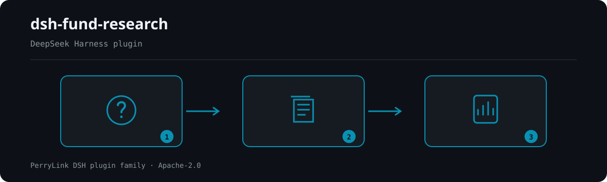

<div align="center">

# 📊 dsh-fund-research
- **1024 store channel**: `npm i -g dsh1024` once, then `dsh1024 plugin --profile web add dsh-fund-research` (counts toward the [deepseek1024.com](https://deepseek1024.com) install ranking).
[](https://gitee.com/perrylink/dsh-fund-research)
[](https://dshfind.com/plugins/PerryLink/dsh-fund-research?ref=badge)
[](https://api.securityscorecards.dev/projects/github.com/PerryLink/dsh-fund-research)

**Deterministic research reports for Chinese public mutual funds, on DeepSeek Harness.**

*Every key number in every report traces back to a hashed source snapshot — gaps declared, never invented. Research only; not investment advice.*

[](LICENSE)
[](https://github.com/topics/dsh-plugin)
[](https://github.com/PerryLink/dsh-plugin-doctor#verified-徽章)
[](https://dsh.market/)
[](#)
[](https://github.com/PerryLink/dsh-fund-research/actions)
[](https://www.npmjs.com/package/dsh-fund-research)
[](https://www.npmjs.com/package/dsh-fund-research)

[English](README.md) · [简体中文](README-zh.md) · [Español](README-es.md) · [Português](README-pt.md) · [हिन्दी](README-hi.md)

```sh
dsh plugin --profile <name> add dsh-fund-research
```


</div>

---

**📖 Ecosystem knowledge base** — measured data, not marketing: [plugin development guide · plugin-selection data · maintenance criteria](https://perrylink.github.io/dsh-plugin-guide/).

<!-- star-cta -->
## Install & uninstall

```sh
dsh plugin --profile web add dsh-fund-research     # install (npm or tarball)
dsh plugin --profile web remove dsh-fund-research  # uninstall
```

Restart the profile after installing (bundle activation is restart-based). The shipped profiles compose the storage stack through `dsh-base` (`dsh-storage` + `dsh-storage-json` + `dsh-storage-domain`); the bundle patch mounts only the plugin row.

## ⭐ 如果它帮到了你

这个插件是 [DSH 插件家族](https://github.com/PerryLink)的一员（95 个，全部 Apache-2.0）。如果你在用，**给个 star** —— 它不会解锁任何功能，但会让下一个人在搜索里更容易找到它。

*English:* part of a 95 plugin family for DeepSeek Harness. If it is useful, **a star helps the next person find it** — nothing is gated behind it.


## What is dsh-fund-research?

Deterministic research reports for Chinese public mutual funds, on DeepSeek Harness.

Every key number in every report traces back to a hashed source snapshot — gaps declared, never invented. Research only; not investment advice.



*Workflow overview: question → sealed sources → report. The examples below use the real command surface.*


## Compatibility

| Component | Version |
|---|---|
| DeepSeek Harness | `dsh-v0.2.1-rc.2` (peer range admits the alpha.2 line: `>=0.1.2-rc.1 <0.2.0 \|\| >=0.1.5-alpha.1 <0.2.0 \|\| >=0.1.6-0 <0.2.0 \|\| >=0.1.7-0 <0.2.0`). On this line `Session.append`'s third parameter is a `SurfaceIntent` for surface-eligible types only, so the `fund-research/*` audit events stay unappended (the tool results and sealed snapshot/report remain the audit trail). Verified 2026-09-24 (dual typecheck rulers + 176 tests). |
| Node.js | `^22.19.0 \|\| >=24.0.0` |
| Package manager | `pnpm@11.7.0` |
| Platform | Windows / macOS / Linux (host-only plugin) |
| Data sources | Tiantian Fund / Eastmoney public endpoints (no key, no login) |

## What you get

- **`fund_research` tool** — one fund code in, a versioned Markdown research report out: overview, performance decomposition, holdings penetration, simplified style attribution, manager profile, risk & gap declarations, disclaimer, and a **number-traceability appendix** mapping every key figure to its snapshot JSON path and verification verdict. Sealed to `fund-reports/{code}/{YYYYMMDD-HHmmss}/` as `report.md` + `manifest.json` + `snapshot.json`. `background: true` runs it as a `fund-report` background job.
- **`fund_snapshot` tool** — a light snapshot card (latest NAV, published stage returns, scale, manager, top-3 holdings) sealed into the fund's day directory.
- **Deterministic metrics, zero model arithmetic** — period/annualized return, volatility, max drawdown, Sharpe; top-N concentration, HHI, industry distribution, quarter-over-quarter holdings comparison; size-value style bands; manager tenure and peer comparison. All pure functions over the sealed snapshot.
- **Traceability as a first-class feature** — before sealing, every key number is checked against the sealed `snapshot.json` through the optional [`dsh-data-quality`](https://github.com/topics/dsh-plugin) service when it is installed, or through the built-in isomorphic fallback checker (`builtin-fallback`) otherwise. The appendix table records value ↔ path ↔ verdict.
- **Honest gaps** — a failed or degraded data source produces an explicit data-gap declaration in the affected section. The plugin never fills a gap with an invented number.
- **Offline mode** — `offline: true` (config or tool argument) serves everything from the storage-domain snapshot layer or the newest on-disk version snapshot, with zero outbound requests. Ideal for tests and reproduction.
- **asOf cutoff** — `asOfDate` (ISO `YYYY-MM-DD`) truncates the NAV series to data on or before that date and stamps the snapshot + report with the cutoff; invalid or future dates fail loudly.
- **Checkpoint resume** — `<reportRoot>/.run-state.json` records each pipeline stage (snapshot/report) with timestamps and an input fingerprint; `resume: true` continues from the first incomplete stage, reusing sealed artifacts, and rejects a fingerprint mismatch.
- **Source discovery record** — every acquisition seals a code-generated `sources-discovery.json` (endpoint roster, primary/fallback resolution, per-source coverage and gaps, degradation reasons) and folds it into the report appendix as 数据源与缺口声明.
- **Multi-fund fan-out** — `codes` accepts an array of fund codes; each fund runs the pipeline independently with per-fund failure isolation (failures become summary gaps), and the result is a summary card (code / asOf / seal hash / verdicts / failure reason).
- **Tracking ledger** — every successful seal appends a deterministic line to `<reportRoot>/.tracking.jsonl`; `includeComparison: true` renders a deterministic 与上次对比 section (NAV range / scale / top holdings) with a gap declaration when no prior record exists.
- **Read-only review** — after sealing, a `fund-review` job reviews the sealed artifacts (gap-declaration completeness, traceability-table consistency, disclaimer) and writes `review-note.md`; it skips gracefully (recorded in run-state) when no jobs service is present.
- **Per-source quality signals** — every source carries deterministic quality metadata (`requested`/`succeeded`/`fieldsPresent`/`parseWarnings`/`degraded`), rendered in the appendix and surfaced in tool values so downstream can downweight (never hard-filter) a low-quality source.
- **Walk-forward stability summary** — `includeWalkForward: true` adds a 样本外稳定性摘要 section: deterministic rolling-window return/Sharpe sign persistence and mean/std, explicitly labelled as statistical description only, not a prediction.
- **Session audit events (host-dependent)** — `fund-research/snapshot` and `fund-research/report` log-only events carry the code, version directory, manifest hash, and gap list (model-visible ⟺ logged) *when the host admits out-of-repo event types*; on `0.1.2-alpha.1`–`0.1.5-alpha.1` hosts the known-type catalog is build-generated in-repo, so the gate appends nothing and the tool results plus sealed artifacts are the audit trail.
- **Methodology skill** — a bundled `fund-research` skill teaches the model the metric口径 (definitions), gap handling, and compliance wording. Computation stays in code.

## Quick start

```sh
dsh plugin --profile web add github:PerryLink/dsh-fund-research
```

```text
> 用 fund_research 出一份 161725 的研究报告
```

The agent calls `fund_research({ code: "161725" })`; a minute later the workspace holds:

```text
fund-reports/161725/20260819-153012/
├── snapshot.json            # raw extracted data + computed metrics + per-source sha256
├── sources-discovery.json   # code-generated endpoint roster + coverage + gaps
├── report.md                # the research report with the traceability appendix
└── manifest.json            # snapshot/report hashes, parameters, verify engine, gaps
```

`.run-state.json` sits at the report root and records the pipeline stages for `resume: true`. Every number in `report.md`'s appendix carries a `verified` / `mismatch` / `not-found` / `unverifiable` verdict against `snapshot.json` — recompute any of them from `raw.*` with the documented口径 to audit the plugin itself.

### Examples

These are the plugin's real entry points; install once, then call one.

#### Detailed example

- `fund_research`

#### Brief examples

- `fund_snapshot`

## Configuration

All keys are optional (defaults shown); invalid values fail loudly at load.

| Key | Default | Description |
|---|---|---|
| `enabled` | `true` | Master switch; `false` mounts nothing at all. |
| `eastmoneyBaseUrl` | `https://fund.eastmoney.com` | Tiantian Fund pingzhongdata host. |
| `f10BaseUrl` | `https://fundf10.eastmoney.com` | Tiantian Fund F10 host (holdings + manager pages). |
| `quoteBaseUrl` | `https://push2.eastmoney.com` | Eastmoney quote host for per-stock valuation snapshots. |
| `quoteFallbackBaseUrl` | `https://push2delay.eastmoney.com` | Fallback quote host tried per stock when the primary fails (Eastmoney's own delayed-quote host); `''` disables it. |
| `requestIntervalMs` | `1000` | Minimum gap between outbound requests (polite collection). |
| `timeoutMs` | `15000` | Per-request timeout. |
| `retries` | `2` | Retries per request with exponential backoff. |
| `cacheTtlHours` | `12` | Storage-domain snapshot reuse window. |
| `riskFreeRate` | `0.02` | Annual risk-free rate for the Sharpe ratio. |
| `offline` | `false` | Never send requests; read the snapshot layer only. |
| `reportRoot` | `fund-reports` | Workspace-relative (or absolute) report tree root. |
| `styleQuotes` | `true` | Fetch per-stock valuation quotes for style attribution. |

## Tools & surfaces

### `fund_research`

| Argument | Type | Description |
|---|---|---|
| `code` | string | Six-digit fund code, e.g. `"161725"` (single fund). Mutually exclusive with `codes`. |
| `codes` | string[] | Multiple six-digit fund codes: a fan-out with per-fund failure isolation (returns a summary). Mutually exclusive with `code`. |
| `sections` | string[] | Section ids to render (`overview`/`performance`/`holdings`/`style`/`manager`/`benchmark`/`risk`/`disclaimer`). Default: all. |
| `offline` | boolean | Read the snapshot layer only (no network). Default: plugin config. |
| `asOfDate` | string | ISO 8601 date (`YYYY-MM-DD`) cutoff: only data on or before it is used (NAV series truncated). Empty = no cutoff; future dates fail loudly. |
| `resume` | boolean | Resume the recorded `.run-state.json` run from the first incomplete stage (reuses sealed artifacts); rejects a fingerprint mismatch. Default: `false`. |
| `includeComparison` | boolean | Render a deterministic 与上次对比 section against the previous `.tracking.jsonl` record; missing evidence is declared as a gap. Default: `false`. |
| `includeWalkForward` | boolean | Render a deterministic 样本外稳定性摘要 (walk-forward) section: rolling-window return/Sharpe sign persistence and mean/std. Statistical description only, not a prediction. Default: `false`. |
| `background` | boolean | Run as a `fund-report` background job; returns `{ kind: "background", jobId }`. Default: `false`. |

### `fund_snapshot`

| Argument | Type | Description |
|---|---|---|
| `code` (required) | string | Six-digit fund code. |
| `offline` | boolean | Read the snapshot layer only. Default: plugin config. |
| `asOfDate` | string | ISO 8601 date (`YYYY-MM-DD`) cutoff: only data on or before it is used. Empty = no cutoff; future dates fail loudly. |

### Report sections

概览 overview · 业绩拆解 performance decomposition · 持仓穿透 holdings penetration · 风格归因 style attribution (simplified) · 经理画像 manager profile · 同类/指数基准对比 benchmark & peer comparison · 风险与缺口声明 risk & gaps · 免责声明 disclaimer · 附录：数字回溯表 traceability appendix.

## Permissions & data

- **Reads** the public Tiantian Fund / Eastmoney endpoints (`fund.eastmoney.com/pingzhongdata/*.js`, `fundf10.eastmoney.com` F10 pages, `push2.eastmoney.com` quotes) with a browser User-Agent and configurable polite pacing. No key, no login, no paid API, no anti-crawler circumvention.
- **Writes** only under the configured report root inside the session workspace, plus the `dsh_fund_research` storage domain (latest snapshot per fund).
- **Never** evaluates remote JavaScript (the pingzhongdata block is scanned, never executed), never stores credentials, never trades.
- Session events are log-only audit records that ride an adaptive gate in `src/events.ts`: they append only when the host admits an out-of-repo type — its known-type set covers the vocabulary, or its `Session.append` takes an `ignorable` envelope. From `0.1.2-alpha.1` on (including `0.1.5-alpha.1`) neither holds: `KNOWN_SESSION_EVENT_TYPES` is a build-generated in-repo catalog that excludes out-of-repo events by construction, and `Session.append` has no `ignorable` option, so the gate appends nothing — the tool results and sealed artifacts remain the reconstructable audit trail, and a failed append never changes a tool outcome.
- 0.1.5-alpha.1 (adapted 2026-09-09): re-verified the gate on the new baseline — the catalog still excludes out-of-repo events and `Session.append` still cannot stamp an `ignorable` envelope, so audit-gate behavior is unchanged.
- 0.1.5-rc.1 (adapted 2026-09-10): dependency pins move to the published 0.1.5-rc.1 line; no seam change affects this plugin's behavior.
- 0.1.5-rc.2 (adapted 2026-09-11): dependency pins move to the published 0.1.5-rc.2 line; no seam change affects this plugin's behavior.

## Security boundaries

- Fund codes are validated as exactly six digits before touching a path or a URL; the report root resolves inside the session workspace.
- Source payloads are hashed (SHA-256) at acquisition; the sealed manifest lets you detect silent upstream edits between runs.
- Verification never blocks a seal: a broken optional `dsh-data-quality` service degrades to the built-in checker, and the engine used is recorded in the manifest and the appendix.
- See [SECURITY.md](SECURITY.md) for the reporting policy.

## Known limitations

- **Upstream structure drift.** The parsers are strict by design: if Tiantian Fund changes a `var Data_*` shape or an F10 table layout, the affected source throws a `SourceParseError` naming the field, and the section degrades to a declared gap (the core pingzhongdata block failing aborts the run loudly). This is deliberate — a silent misparse is worse than a declared gap.
- **Style attribution is估算口径.** Fixed size bands (≥1000亿 / 300–1000亿 / <300亿) and PE bands, plus within-holdings quintiles — no full-market distribution is consulted. The report labels this.
- **Holdings are quarterly disclosure data** (披露滞后); the F10 page carries the latest two quarters.
- **Single-`code` calls are one fund; `codes` is a fan-out over multiple funds.** No cross-fund portfolio analysis, no PDF annual reports, no real-time quotes (the `fundgz.1234567.com.cn` realtime endpoint is dead and deliberately unused).
- The Web UI "deliverables" turn row keys off mutation-tool call cards; this plugin's produced files surface through the tool call card's follow-along location (the fund's report directory), not per-file rows.

## Development

```sh
pnpm install
pnpm run typecheck && pnpm run typecheck:ci && pnpm run typecheck:checkout   # types, incl. CI-strict
pnpm test                                     # 176 tests over real harness seams
pnpm run test:e2e                              # opt-in LIVE-network E2E (LIVE_E2E=1)
pnpm run build && pnpm run verify:artifacts   # tsdown + tsc declarations
pnpm run verify:self-contained                # no out-of-repo dependency specs
node scripts/check-readme-sync.mjs            # five-language README gate
node scripts/check-endpoints.mjs              # M3 endpoint-liveness probe (4 eastmoney hosts)
pnpm pack                                     # tarball
```

Tests run the REAL `Context`/`SessionStore`/`ToolRuntime`/`LocalJobRegistry`/storage seam from the 0.1.7-rc.2 peers; the network is replaced only at the fetch boundary by saved real-response fixtures (`fixtures/`, fund 161725). Refresh fixtures with the collector scripts in `.tmp/`.

## Topics

`dsh` · `dsh-plugin` · `deepseek-harness` · `cordis` · `fund-research` · `mutual-fund` · `investment-research` · `finance` · `research-report`

## Contributors

- **PerryLink** — maintainer: the collector/metrics/report-seal pipeline, the endpoint-liveness probe, CI and releases, and the five-language docs.
- **dsh-fund-research contributors** — collective author of the foundational build (plugin contract, config schema, tools, tests, packaging).

No external contributors yet — 0 community PRs/issues merged. Open an issue via the forms in `.github/ISSUE_TEMPLATE/` or a pull request against `main` to be listed here.

## PerryLink DSH Plugin Family

This project is part of the DeepSeek Harness plugin family from [PerryLink](https://github.com/PerryLink). The roster stays collapsed below so every README keeps a short first screen; expand it to see every row and its status.

<details>
<summary>Expand all plugins</summary>

| Plugin | Status |
|---|---|
| **[dsh-aqua-input-check](https://github.com/PerryLink/dsh-aqua-input-check)** |  |
| **[dsh-archive-check](https://github.com/PerryLink/dsh-archive-check)** |  |
| **[dsh-auto-review](https://github.com/PerryLink/dsh-auto-review)** |  |
| **[dsh-autotier](https://github.com/PerryLink/dsh-autotier)** |  |
| **[dsh-bid-ca-precheck](https://github.com/PerryLink/dsh-bid-ca-precheck)** |  |
| **[dsh-bid-qual-check](https://github.com/PerryLink/dsh-bid-qual-check)** |  |
| **[dsh-cert-mcp](https://github.com/PerryLink/dsh-cert-mcp)** |  |
| **[dsh-checkpoint-rewind](https://github.com/PerryLink/dsh-checkpoint-rewind)** |  |
| **[dsh-click](https://github.com/PerryLink/dsh-click)** |  |
| **[dsh-composer-history](https://github.com/PerryLink/dsh-composer-history)** |  |
| **[dsh-contract-stance](https://github.com/PerryLink/dsh-contract-stance)** |  |
| **[dsh-customs-doc-check](https://github.com/PerryLink/dsh-customs-doc-check)** |  |
| **[dsh-data-quality](https://github.com/PerryLink/dsh-data-quality)** |  |
| **[dsh-demurrage-ledger](https://github.com/PerryLink/dsh-demurrage-ledger)** |  |
| **[dsh-doublecheck](https://github.com/PerryLink/dsh-doublecheck)** |  |
| **[dsh-drill-script-check](https://github.com/PerryLink/dsh-drill-script-check)** |  |
| **[dsh-eia-guide-check](https://github.com/PerryLink/dsh-eia-guide-check)** |  |
| **[dsh-emergency-plan](https://github.com/PerryLink/dsh-emergency-plan)** |  |
| **[dsh-essay-rubric-check](https://github.com/PerryLink/dsh-essay-rubric-check)** |  |
| **[dsh-evidence-check](https://github.com/PerryLink/dsh-evidence-check)** |  |
| **[dsh-export-ctl-check](https://github.com/PerryLink/dsh-export-ctl-check)** |  |
| **[dsh-fast](https://github.com/PerryLink/dsh-fast)** |  |
| **[dsh-fmea-table-check](https://github.com/PerryLink/dsh-fmea-table-check)** |  |
| **[dsh-forecast-penalty](https://github.com/PerryLink/dsh-forecast-penalty)** |  |
| **[dsh-fund-research](https://github.com/PerryLink/dsh-fund-research)** |  |
| **[dsh-github](https://github.com/PerryLink/dsh-github)** |  |
| **[dsh-gongwen-flow-check](https://github.com/PerryLink/dsh-gongwen-flow-check)** |  |
| **[dsh-gongwen-word-check](https://github.com/PerryLink/dsh-gongwen-word-check)** |  |
| **[dsh-guard-plan-qc](https://github.com/PerryLink/dsh-guard-plan-qc)** |  |
| **[dsh-hazchem-check](https://github.com/PerryLink/dsh-hazchem-check)** |  |
| **[dsh-hazplan-check](https://github.com/PerryLink/dsh-hazplan-check)** |  |
| **[dsh-hidden-risk-map](https://github.com/PerryLink/dsh-hidden-risk-map)** |  |
| **[dsh-hs-classify](https://github.com/PerryLink/dsh-hs-classify)** |  |
| **[dsh-icd-rule-check](https://github.com/PerryLink/dsh-icd-rule-check)** |  |
| **[dsh-industry-research](https://github.com/PerryLink/dsh-industry-research)** |  |
| **[dsh-lawcite-adapter](https://github.com/PerryLink/dsh-lawcite-adapter)** |  |
| **[dsh-laya](https://github.com/PerryLink/dsh-laya)** |  |
| **[dsh-lc-doc-check](https://github.com/PerryLink/dsh-lc-doc-check)** |  |
| **[dsh-learning-gap-check](https://github.com/PerryLink/dsh-learning-gap-check)** |  |
| **[dsh-library](https://github.com/PerryLink/dsh-library)** |  |
| **[dsh-local-ai](https://github.com/PerryLink/dsh-local-ai)** |  |
| **[dsh-lsp-actions](https://github.com/PerryLink/dsh-lsp-actions)** |  |
| **[dsh-mask](https://github.com/PerryLink/dsh-mask)** |  |
| **[dsh-mcp-panel](https://github.com/PerryLink/dsh-mcp-panel)** |  |
| **[dsh-medrec-qc](https://github.com/PerryLink/dsh-medrec-qc)** |  |
| **[dsh-memento](https://github.com/PerryLink/dsh-memento)** |  |
| **[dsh-nsfc-form-check](https://github.com/PerryLink/dsh-nsfc-form-check)** |  |
| **[dsh-nurse-record-check](https://github.com/PerryLink/dsh-nurse-record-check)** |  |
| **[dsh-observe](https://github.com/PerryLink/dsh-observe)** |  |
| **[dsh-origin-rvc-check](https://github.com/PerryLink/dsh-origin-rvc-check)** |  |
| **[dsh-ota-review-check](https://github.com/PerryLink/dsh-ota-review-check)** |  |
| **[dsh-output-styles](https://github.com/PerryLink/dsh-output-styles)** |  |
| **[dsh-paper-doc-adapter](https://github.com/PerryLink/dsh-paper-doc-adapter)** |  |
| **[dsh-permission-rules](https://github.com/PerryLink/dsh-permission-rules)** |  |
| **[dsh-permit-report-check](https://github.com/PerryLink/dsh-permit-report-check)** |  |
| **[dsh-pipeline-check](https://github.com/PerryLink/dsh-pipeline-check)** |  |
| **[dsh-pleading-draft](https://github.com/PerryLink/dsh-pleading-draft)** |  |
| **[dsh-plugin-doctor](https://github.com/PerryLink/dsh-plugin-doctor)** |  |
| **[dsh-plugin-guide](https://github.com/PerryLink/dsh-plugin-guide)** |  |
| **[dsh-plugin-kit](https://github.com/PerryLink/dsh-plugin-kit)** |  |
| **[dsh-plugin-upgrade](https://github.com/PerryLink/dsh-plugin-upgrade)** |  |
| **[dsh-policy-brief-draft](https://github.com/PerryLink/dsh-policy-brief-draft)** |  |
| **[dsh-power-loss-split](https://github.com/PerryLink/dsh-power-loss-split)** |  |
| **[dsh-power-ticket-check](https://github.com/PerryLink/dsh-power-ticket-check)** |  |
| **[dsh-ppap-check](https://github.com/PerryLink/dsh-ppap-check)** |  |
| **[dsh-protest-deadline](https://github.com/PerryLink/dsh-protest-deadline)** |  |
| **[dsh-railway-window](https://github.com/PerryLink/dsh-railway-window)** |  |
| **[dsh-repair-order-qc](https://github.com/PerryLink/dsh-repair-order-qc)** |  |
| **[dsh-research-report](https://github.com/PerryLink/dsh-research-report)** |  |
| **[dsh-review-reply-check](https://github.com/PerryLink/dsh-review-reply-check)** |  |
| **[dsh-rulefile-check](https://github.com/PerryLink/dsh-rulefile-check)** |  |
| **[dsh-safety-brief-check](https://github.com/PerryLink/dsh-safety-brief-check)** |  |
| **[dsh-score](https://github.com/PerryLink/dsh-score)** |  |
| **[dsh-session-sync](https://github.com/PerryLink/dsh-session-sync)** |  |
| **[dsh-site-log-check](https://github.com/PerryLink/dsh-site-log-check)** |  |
| **[dsh-skill-pack-security](https://github.com/PerryLink/dsh-skill-pack-security)** |  |
| **[dsh-soe-decision-check](https://github.com/PerryLink/dsh-soe-decision-check)** |  |
| **[dsh-soilwater-check](https://github.com/PerryLink/dsh-soilwater-check)** |  |
| **[dsh-sop-sync-check](https://github.com/PerryLink/dsh-sop-sync-check)** |  |
| **[dsh-spc-gbt-adapter](https://github.com/PerryLink/dsh-spc-gbt-adapter)** |  |
| **[dsh-talk](https://github.com/PerryLink/dsh-talk)** |  |
| **[dsh-tender-extract](https://github.com/PerryLink/dsh-tender-extract)** |  |
| **[dsh-tender-matrix](https://github.com/PerryLink/dsh-tender-matrix)** |  |
| **[dsh-test-drive](https://github.com/PerryLink/dsh-test-drive)** |  |
| **[dsh-ticktick](https://github.com/PerryLink/dsh-ticktick)** |  |
| **[dsh-translate](https://github.com/PerryLink/dsh-translate)** |  |
| **[dsh-warranty-calc](https://github.com/PerryLink/dsh-warranty-calc)** |  |
| **[dsh-budget](https://github.com/PerryLink/dsh-budget)** | 🧊 FROZEN — see the repo README |
| **[dsh-claude-move](https://github.com/PerryLink/dsh-claude-move)** | 🧊 FROZEN — see the repo README |
| **[dsh-defend](https://github.com/PerryLink/dsh-defend)** | 🧊 FROZEN — see the repo README |
| **[dsh-draw](https://github.com/PerryLink/dsh-draw)** | 🧊 FROZEN — see the repo README |
| **[dsh-reach](https://github.com/PerryLink/dsh-reach)** | 🧊 FROZEN — see the repo README |
| **[dsh-background-agents](https://github.com/PerryLink/dsh-background-agents)** | 🚫 RETIRED — see the repo README |
| **[dsh-session-pin](https://github.com/PerryLink/dsh-session-pin)** | 🚫 RETIRED — see the repo README |
| **[dsh-team-rooms](https://github.com/PerryLink/dsh-team-rooms)** | 🚫 RETIRED — see the repo README |

</details>
