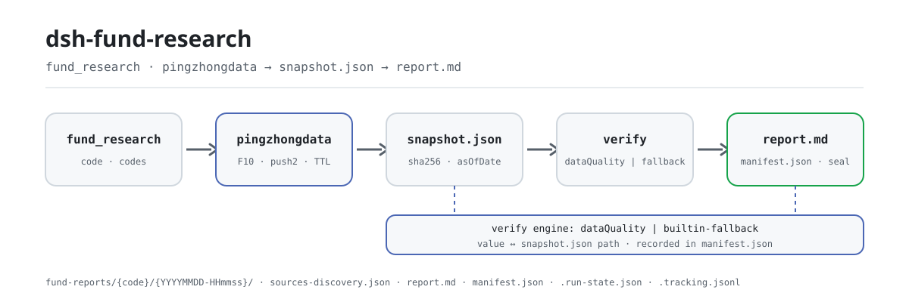

<div align="center">

<picture>
  <source media="(prefers-color-scheme: dark)" srcset="docs/assets/dsh-fund-research-flow-dark.svg">
  
</picture>

# dsh-fund-research

**Informe um código de fundo de seis dígitos e receba um relatório de pesquisa selado, com cada número rastreável e cada lacuna declarada.**

Plugin de pesquisa de fundos mútuos públicos chineses para o DeepSeek Harness: coleta dados públicos dos endpoints do Tiantian Fund / Eastmoney com ritmo educado, calcula todas as métricas de forma determinística em código e sela o relatório junto com o snapshot de origem no seu workspace — apenas para pesquisa, não é aconselhamento de investimento.

[Instalar](#instalação-em-três-passos) · [Configuração](#configuração) · [FAQ](#faq) · [简体中文](README.md) · [English](README.en.md) · [Español](README.es.md) · [Português](README.pt.md) · [हिन्दी](README.hi.md)

[](LICENSE)
[](#compatibilidade)
[](https://www.npmjs.com/package/dsh-fund-research)
[](https://github.com/PerryLink/dsh-fund-research/actions/workflows/ci.yml)
[](#compatibilidade)

[](https://github.com/PerryLink/dsh-fund-research/stargazers)
[](https://www.npmjs.com/package/dsh-fund-research)
[](https://dshfind.com/plugins/PerryLink/dsh-fund-research?ref=badge)
[](https://securityscorecards.dev/viewer/?uri=github.com/PerryLink/dsh-fund-research)
[](https://dsh.market/)
[](https://gitee.com/perrylink/dsh-fund-research)

```sh
dsh plugin --profile <name> add dsh-fund-research
```

</div>

<sub>Plugin da comunidade, sem afiliação com a DeepSeek. Repositório canônico: <https://github.com/PerryLink/dsh-fund-research> (o Gitee é um espelho).</sub>

## O que é

Dê ao modelo um código de fundo de seis dígitos e o `dsh-fund-research` coleta os dados públicos desse fundo, executa um conjunto determinístico de métricas, verifica cada número-chave contra o snapshot de origem antes de selar e grava o relatório — junto com o snapshot, o registro de aquisição e o manifesto — no seu workspace. Cada número do apêndice tem sua linha valor ↔ caminho JSON no snapshot ↔ veredito, então você pode recalculá-lo a partir de `raw.*` com as convenções documentadas e auditar o próprio plugin. Quando uma fonte falha ou degrada, a seção afetada carrega uma declaração explícita de lacuna de dados; o plugin nunca preenche uma lacuna com um número inventado. Plugin apenas de host: não opera, não prevê, não é aconselhamento de investimento.

## Instalação em três passos

1. **Instalar** (escolha um canal):

   ```sh
   # canal npm (versões publicadas)
   dsh plugin --profile web add dsh-fund-research
   # canal git (main mais recente)
   dsh plugin --profile web add github:PerryLink/dsh-fund-research
   # canal tarball: após pnpm pack neste repositório
   dsh plugin --profile web add ./dsh-fund-research-<version>.tgz
   ```

   Reinicie o perfil após instalar (a ativação do bundle é por reinício). Os perfis incluídos compõem a pilha de armazenamento via `dsh-base` (`dsh-storage` + `dsh-storage-json` + `dsh-storage-domain`); o patch do bundle monta apenas a linha do plugin. Um perfil nu precisa compor a pilha por conta própria; caso contrário o plugin não monta.

2. **Configuração mínima** (os padrões funcionam; ajuste a raiz do relatório e a política de coleta se precisar):

   ```yaml
   - insert:
       - id: dsh-fund-research
         name: dsh-fund-research
         config:
           offline: false
           reportRoot: fund-reports
           cacheTtlHours: 12
   ```

3. **Verificar que funciona**: basta pedir ao agente; o plugin chama `fund_research`:

   ```text
   > use fund_research para gerar um relatório de pesquisa do 161725
   ```

   Em instantes o workspace contém um diretório versionado:

   ```text
   fund-reports/161725/20260819-153012/
   ├── snapshot.json            # dados extraídos + métricas calculadas + sha256 por fonte
   ├── sources-discovery.json   # lista de endpoints gerada + cobertura + lacunas
   ├── report.md                # relatório com o apêndice de rastreabilidade
   └── manifest.json            # hashes, parâmetros, motor de verificação, lacunas
   ```

**Desinstalar**: `dsh plugin --profile web remove dsh-fund-research` (ou remova a linha do patch do perfil).

### Exemplos

Estes são os pontos de entrada reais do plugin; instale uma vez e chame um.

**Exemplo detalhado** — comando:

```sh
fund_research({ code: "161725", sections: ["overview", "disclaimer"] })
```

Saída:

```text
招商中证白酒指数(LOF)A（161725）研究报告已封存 — 仅供研究参考，不构成投资建议
版本目录 20261019-124928；报告 fund-reports/161725/20261019-124928/report.md
manifest fund-reports/161725/20261019-124928/manifest.json（报告 sha256 f74b1446d544…）
数字回溯表核查（builtin-fallback）：verified 5 / mismatch 0 / not-found 0 / unverifiable 0
采集方式：快照复用（offline）；章节：overview、disclaimer
```

*Observed from `README.md:99-113,149-161; test/tools.spec.ts:150-171; src/tools/research.ts:121-130`*

**Ramo de falha** — entrada:

```text
{"code":"161725","asOfDate":"2024-02-30"}
```

Saída:

```text
isError=true; error.message=asOfDate must be a real calendar date, got "2024-02-30"
```

*Observed from `plugins/dsh-fund-research/src/sources/snapshot.ts:167 (parseAsOfDate); plugins/dsh-fund-research/README.md:173 (invalid dates fail loudly); exercised through plugins/dsh-fund-research/test/harness.ts`*

**Exemplos curtos**: `fund_snapshot`

## Capacidades principais

O `dsh-fund-research` divide uma pesquisa em quatro etapas — coletar → calcular → verificar → selar — e cada etapa deixa um artefato re-verificável:

- **Ferramenta `fund_research`** — um código de fundo entra, um relatório Markdown versionado sai: visão geral, decomposição de desempenho, penetração de posições, atribuição de estilo simplificada, perfil do gestor, comparação com benchmark e pares, declarações de risco e lacunas, aviso legal e um **apêndice de rastreabilidade numérica** que mapeia cada número-chave ao caminho JSON no snapshot e ao veredito. Selado em `fund-reports/{code}/{YYYYMMDD-HHmmss}/` como `report.md` + `manifest.json` + `snapshot.json`. `background: true` executa como job em segundo plano `fund-report`.
- **Ferramenta `fund_snapshot`** — um cartão leve (último NAV, retornos por etapa publicados, escala, gestor, 3 principais posições) selado no diretório do dia do fundo.
- **Métricas determinísticas, zero aritmética do modelo** — retorno por período/anualizado, volatilidade, drawdown máximo, Sharpe; concentração top-N, HHI, distribuição setorial, comparação trimestral de posições; faixas de estilo tamanho-valor; tenure do gestor e comparação com pares. Tudo funções puras sobre o snapshot selado.
- **Rastreabilidade como recurso principal** — antes de selar, cada número-chave é verificado contra o `snapshot.json` selado pelo serviço opcional [`dsh-data-quality`](https://github.com/topics/dsh-plugin) quando instalado, ou pelo verificador integrado isomórfico (`builtin-fallback`) caso contrário. A tabela do apêndice registra valor ↔ caminho ↔ veredito.
- **Lacunas honestas** — uma fonte que falhou ou degradou produz uma declaração explícita de lacuna de dados na seção afetada. O plugin nunca preenche uma lacuna com um número inventado.
- **Modo offline** — `offline: true` (configuração ou argumento da ferramenta) serve tudo da camada de snapshots do domínio de armazenamento ou do snapshot mais recente em disco, sem nenhuma requisição de saída. Ideal para testes e reprodução.
- **Corte asOf** — `asOfDate` (ISO `YYYY-MM-DD`) trunca a série de NAV até essa data inclusive e marca o snapshot e o relatório com o corte; datas inválidas ou futuras falham ruidosamente.
- **Retomada por checkpoint** — `<reportRoot>/.run-state.json` registra cada etapa (snapshot/relatório) com timestamps e impressão digital de entrada; `resume: true` continua da primeira etapa incompleta, reutiliza artefatos selados e rejeita impressão digital divergente.
- **Registro de descoberta de fontes** — cada aquisição sela um `sources-discovery.json` gerado por código (lista de endpoints, resolução primária/de fallback, cobertura e lacunas por fonte, motivos de degradação) e o incorpora ao apêndice como declaração de fontes e lacunas.
- **Fan-out multifundo** — `codes` aceita um array de códigos; cada fundo executa seu pipeline de forma independente com isolamento de falhas (falhas viram lacunas no resumo) e o resultado é um cartão-resumo (code / asOf / hash do selo / vereditos / motivo da falha).
- **Livro de rastreamento** — cada selo bem-sucedido acrescenta uma linha determinística a `<reportRoot>/.tracking.jsonl`; `includeComparison: true` renderiza uma seção determinística de comparação com a execução anterior (faixa de NAV / escala / principais posições), com declaração de lacuna quando não há registro anterior.
- **Revisão somente leitura** — após selar, um job `fund-review` revisa os artefatos selados (completude das lacunas, consistência da tabela de rastreabilidade, aviso legal) e grava `review-note.md`; é ignorado com elegância (registrado no run-state) quando não há serviço de jobs.
- **Sinais de qualidade por fonte** — cada fonte carrega metadados determinísticos de qualidade (`requested`/`succeeded`/`fieldsPresent`/`parseWarnings`/`degraded`), presentes no apêndice e nos valores da ferramenta para que o consumidor possa penalizar (nunca filtrar em duro) uma fonte de baixa qualidade.
- **Resumo de estabilidade fora da amostra** — `includeWalkForward: true` acrescenta uma seção de estabilidade fora da amostra: persistência de sinal e média/desvio de retorno/Sharpe em janelas móveis determinísticas, explicitamente rotulada como descrição estatística, não previsão.
- **Eventos de auditoria de sessão (depende do host)** — os eventos somente-log `fund-research/snapshot` e `fund-research/report` carregam o código, o diretório de versão, o hash do manifesto e a lista de lacunas (visível ao modelo ⟺ registrado) *quando o host admite tipos de evento externos ao repositório*; em hosts `0.1.2-alpha.1`–`0.1.5-alpha.1` o catálogo de tipos conhecidos é gerado no build dentro do repositório, então o portão não adiciona nada e os resultados das ferramentas mais os artefatos selados são o rastro de auditoria.
- **Skill de metodologia** — um skill `fund-research` incluído ensina ao modelo as convenções das métricas, o tratamento de lacunas e a linguagem de conformidade; o cálculo permanece no código.

### Ferramentas e superfícies

**Argumentos de `fund_research`**:

| Argumento | Tipo | Descrição |
|---|---|---|
| `code` | string | Código de fundo de seis dígitos, ex. `"161725"` (um fundo). Exclusivo com `codes`. |
| `codes` | string[] | Vários códigos de seis dígitos: fan-out com isolamento de falhas por fundo (retorna um resumo). Exclusivo com `code`. |
| `sections` | string[] | Seções a renderizar (`overview`/`performance`/`holdings`/`style`/`manager`/`benchmark`/`risk`/`disclaimer`). Padrão: todas. |
| `offline` | boolean | Ler apenas a camada de snapshots (sem rede). Padrão: configuração do plugin. |
| `asOfDate` | string | Data ISO 8601 (`YYYY-MM-DD`) de corte: só dados até essa data são usados (série de NAV truncada). Vazio = sem corte; datas futuras falham ruidosamente. |
| `resume` | boolean | Retoma a execução registrada em `.run-state.json` a partir da primeira etapa incompleta (reutiliza artefatos selados); rejeita impressão digital divergente. Padrão: `false`. |
| `includeComparison` | boolean | Renderiza uma seção determinística de comparação com a execução anterior segundo o registro de `.tracking.jsonl`; evidência ausente é declarada como lacuna. Padrão: `false`. |
| `includeWalkForward` | boolean | Renderiza uma seção determinística de estabilidade fora da amostra (walk-forward): persistência de sinal e média/desvio em janelas móveis. Apenas descrição estatística, não previsão. Padrão: `false`. |
| `background` | boolean | Executa como job em segundo plano `fund-report`; retorna `{ kind: "background", jobId }`. Padrão: `false`. |

**Argumentos de `fund_snapshot`**:

| Argumento | Tipo | Descrição |
|---|---|---|
| `code` (obrigatório) | string | Código de fundo de seis dígitos. |
| `offline` | boolean | Ler apenas a camada de snapshots. Padrão: configuração do plugin. |
| `asOfDate` | string | Data ISO 8601 (`YYYY-MM-DD`) de corte: só dados até essa data são usados. Vazio = sem corte; datas futuras falham ruidosamente. |

**Seções do relatório**: visão geral · decomposição de desempenho · penetração de posições · atribuição de estilo (simplificada) · perfil do gestor · comparação com benchmark e pares · declarações de risco e lacunas · aviso legal · apêndice: tabela de rastreabilidade. Cada número do apêndice de `report.md` carrega um veredito `verified` / `mismatch` / `not-found` / `unverifiable` contra `snapshot.json`; qualquer pessoa pode recalculá-lo a partir de `raw.*` com as convenções documentadas e auditar o plugin.

## Configuração

Todas as chaves são opcionais (os padrões são mostrados); valores inválidos falham ruidosamente no carregamento. O `cordis.patch.yml` documenta cada chave em linha.

Chaves mais usadas:

| Chave | Padrão | Significado |
|---|---|---|
| `enabled` | `true` | Interruptor mestre; `false` não monta nada. |
| `promptSection` | `false` | Registra a breve declaração de papel de pesquisa de fundos no system prompt de todo o deployment. Desligado por padrão; `true` afeta cada sessão do perfil. |
| `offline` | `false` | Nunca enviar requisições; ler apenas a camada de snapshots. |
| `reportRoot` | `fund-reports` | Raiz da árvore de relatórios (relativa ao workspace ou absoluta). |
| `cacheTtlHours` | `12` | Janela de reutilização de snapshots do domínio de armazenamento. |
| `requestIntervalMs` | `1000` | Intervalo mínimo entre requisições de saída (coleta educada). |
| `riskFreeRate` | `0.02` | Taxa livre de risco anual usada pelo índice de Sharpe. |

<details>
<summary>Tabela completa de configuração (14 chaves)</summary>

| Chave | Padrão | Significado |
|---|---|---|
| `enabled` | `true` | Interruptor mestre; `false` não monta nada. |
| `promptSection` | `false` | Registra a breve declaração de papel de pesquisa de fundos no system prompt de todo o deployment. Desligado por padrão; `true` afeta cada sessão do perfil. |
| `eastmoneyBaseUrl` | `https://fund.eastmoney.com` | Host de pingzhongdata do Tiantian Fund. |
| `f10BaseUrl` | `https://fundf10.eastmoney.com` | Host F10 do Tiantian Fund (páginas de posições e gestor). |
| `quoteBaseUrl` | `https://push2.eastmoney.com` | Host de cotações da Eastmoney para snapshots de valuation por ação. |
| `quoteFallbackBaseUrl` | `https://push2delay.eastmoney.com` | Host de cotações de fallback por ação quando o primário falha (host de cotação atrasada da Eastmoney); `''` desativa. |
| `requestIntervalMs` | `1000` | Intervalo mínimo entre requisições de saída (coleta educada). |
| `timeoutMs` | `15000` | Timeout por requisição. |
| `retries` | `2` | Tentativas por requisição com backoff exponencial. |
| `cacheTtlHours` | `12` | Janela de reutilização de snapshots do domínio de armazenamento. |
| `riskFreeRate` | `0.02` | Taxa livre de risco anual usada pelo índice de Sharpe. |
| `offline` | `false` | Nunca enviar requisições; ler apenas a camada de snapshots. |
| `reportRoot` | `fund-reports` | Raiz da árvore de relatórios (relativa ao workspace ou absoluta). |
| `styleQuotes` | `true` | Buscar cotações de valuation por ação para a atribuição de estilo. |

</details>

Exemplo de override no patch do perfil:

```yaml
- insert:
    - id: dsh-fund-research
      name: dsh-fund-research
      config:
        reportRoot: research/funds
        requestIntervalMs: 1500
        offline: false
```

## FAQ

<details>
<summary>Onde ficam o relatório e o snapshot? Uma nova execução sobrescreve a anterior?</summary>

Cada selo bem-sucedido grava um diretório de versão independente `<reportRoot>/<code>/<YYYYMMDD-HHmmss>/` e nunca sobrescreve uma versão antiga; `.tracking.jsonl` só acrescenta linhas e `.run-state.json` guarda o estado de retomada. O domínio de armazenamento `dsh_fund_research` mantém apenas o snapshot mais recente por fundo (limitado pela janela de reutilização `cacheTtlHours`). `reportRoot` pode ser um caminho relativo ao workspace ou absoluto.

</details>

<details>
<summary>O que acontece se uma fonte cair ou uma página mudar? Ele vai inventar números?</summary>

Não. Os parsers são estritos por design: quando a estrutura de uma fonte deriva, ela lança um `SourceParseError` nomeando o campo, e a seção afetada degrada para uma declaração explícita de lacuna; se o bloco central de pingzhongdata falhar, a execução inteira falha ruidosamente. A verificação nunca bloqueia o selo: se o serviço opcional `dsh-data-quality` estiver ausente ou quebrado, o plugin usa o verificador integrado `builtin-fallback`, e o motor realmente usado fica registrado no manifesto e no apêndice.

</details>

<details>
<summary>Ele disputa nomes de ferramenta, serviços ou eventos com outros plugins?</summary>

Não. O plugin não registra nenhum listener waterfall, nem slot de cliente, nem prefixo `webServer`; seus dois nomes de ferramenta `fund_snapshot` / `fund_research` são independentes; os serviços opcionais (`jobs`, `skills`, `systemPrompt`, `dataQuality`) são lidos via `ctx.get` e ignorados ou degradados quando ausentes em vez de bloquear a montagem; o patch do bundle apenas `insert`a a própria linha. O detalhe ponto a ponto está em «Interoperabilidade com outros plugins DSH».

</details>

<details>
<summary>Quanto tempo leva uma pesquisa? Qual é o custo de desempenho?</summary>

Uma execução de `fund_research` é um número limitado de requisições HTTP mais cálculo de funções puras mais um selo com hash. A saída é regulada por `requestIntervalMs` (1000 ms por padrão), cada requisição tem `timeoutMs` de 15 s e `retries` 2; repetir o mesmo fundo dentro de 12 horas pode reutilizar o snapshot (`cacheTtlHours`), e `offline: true` não faz nenhuma requisição e lê apenas dados selados. O cálculo são funções puras: sem participação do modelo e sem chamadas extras ao modelo.

</details>

## Limites de segurança

- Códigos de fundo são validados como exatamente seis dígitos antes de tocar um caminho ou uma URL; a raiz do relatório é resolvida dentro do workspace da sessão.
- Os payloads das fontes recebem hash (SHA-256) na aquisição; o manifesto selado permite detectar edições silenciosas do upstream entre execuções.
- A verificação nunca bloqueia o selo: um serviço opcional `dsh-data-quality` quebrado degrada para o verificador integrado, e o motor usado fica registrado no manifesto e no apêndice.
- Veja [SECURITY.md](SECURITY.md) para a política de reporte.

## Permissões e dados

- **Lê** os endpoints públicos do Tiantian Fund / Eastmoney (`fund.eastmoney.com/pingzhongdata/*.js`, páginas F10 de `fundf10.eastmoney.com`, cotações de `push2.eastmoney.com`) com User-Agent de navegador e ritmo educado configurável. Sem chave, sem login, sem API paga, sem contornar anti-bots.
- **Grava** apenas sob a raiz de relatórios configurada dentro do workspace da sessão, mais o domínio de armazenamento `dsh_fund_research` (último snapshot por fundo).
- **Nunca** executa JavaScript remoto (o bloco pingzhongdata é escaneado, nunca executado), nunca armazena credenciais, nunca opera.
- Os eventos de sessão são registros de auditoria somente-log que passam por um portão adaptativo em `src/events.ts`: só são adicionados quando o host admite um tipo externo ao repositório — seu conjunto de tipos conhecidos cobre o vocabulário, ou seu `Session.append` aceita um envelope `ignorable`. A partir de `0.1.2-alpha.1` (incluindo `0.1.5-alpha.1`) nenhum dos dois vale: `KNOWN_SESSION_EVENT_TYPES` é um catálogo gerado no build dentro do repositório que exclui por construção eventos externos, e `Session.append` não tem opção `ignorable`, então o portão não adiciona nada — os resultados das ferramentas e os artefatos selados continuam sendo o rastro de auditoria reconstruível, e uma falha de append nunca muda o resultado de uma ferramenta.
- 0.1.5-alpha.1 (adaptado 2026-09-09): portão re-verificado na nova base — o catálogo ainda exclui eventos externos e `Session.append` ainda não consegue carimbar um envelope `ignorable`, então o comportamento do portão não muda.
- 0.1.5-rc.1 (adaptado 2026-09-10): os pins de dependência passam para a linha publicada 0.1.5-rc.1; nenhuma mudança de seam afeta o comportamento do plugin.
- 0.1.5-rc.2 (adaptado 2026-09-11): os pins de dependência passam para a linha publicada 0.1.5-rc.2; nenhuma mudança de seam afeta o comportamento do plugin.
- A declaração de papel de pesquisa de fundos é **opcional** (`promptSection: true`) e, quando ativada, é de todo o deployment: afeta cada sessão do perfil que vê as ferramentas de fundos, incluindo as que nunca as chamam.

## Limitações conhecidas

- **Deriva de estrutura do upstream.** Os parsers são estritos por design: se o Tiantian Fund mudar a forma de um `var Data_*` ou o layout de uma tabela F10, a fonte afetada lança um `SourceParseError` nomeando o campo, e a seção degrada para uma lacuna declarada (se o bloco central de pingzhongdata falhar, a execução aborta ruidosamente). É deliberado: um parse silenciosamente errado é pior que uma lacuna declarada.
- **A atribuição de estilo é uma convenção de estimativa.** Faixas fixas de tamanho (≥100 bilhões CNY / 30–100 bilhões CNY / <30 bilhões CNY) e faixas de P/L, mais quintis dentro das posições — nenhuma distribuição de mercado inteiro é consultada. O relatório rotula isso.
- **As posições são dados de divulgação trimestral** (com atraso de divulgação); a página F10 traz os dois últimos trimestres.
- **Uma chamada com `code` é um fundo; `codes` é um fan-out sobre vários fundos.** Sem análise de carteira entre fundos, sem relatórios anuais em PDF, sem cotações em tempo real (o endpoint em tempo real `fundgz.1234567.com.cn` está morto e não é usado de propósito).
- A linha de «deliverables» da Web UI é acionada pelos cartões de chamada de ferramentas mutadoras; os arquivos produzidos por este plugin aparecem na localização de acompanhamento do cartão de chamada (o diretório do relatório do fundo), não como linhas por arquivo.

## Interoperabilidade com outros plugins DSH

O plugin não registra nenhum listener waterfall e não se apropria da cadeia de eventos de ninguém; oferece apenas duas ferramentas, uma seção de prompt opcional, um provedor de skills opcional e um domínio de armazenamento. Ponto a ponto:

- **Sem colisão de nomes de ferramenta.** Registra apenas as ferramentas com namespace `fund_snapshot` e `fund_research`, e nenhum nome nu de ferramenta integrada ou de outro plugin.
- **Sem colisão de chaves de serviço.** Não oferece nenhuma chave de serviço; `jobs`, `skills`, `systemPrompt` e `dataQuality` são buscas `ctx.get` somente leitura que são ignoradas em silêncio quando ausentes.
- **Sem colisão de slots ou rotas HTTP.** Plugin apenas de host: sem slot de cliente, sem prefixo `webServer`.
- **Sem colisão de camada de patch.** O patch do bundle apenas `insert`a a própria linha e nunca sobrescreve o `config` de uma linha integrada.
- **A dependência opcional é um contrato estrutural.** `dsh-data-quality` é consumido por uma interface estrutural local (`src/verify-bridge.ts`), nunca importado; se o serviço quebrar, o plugin degrada para o verificador integrado `builtin-fallback` e registra o motor no manifesto e no apêndice.
- **Isolamento do domínio de armazenamento.** Os snapshots vão para o próprio domínio `dsh_fund_research`; a pilha de armazenamento é composta pelo perfil via `dsh-base`, e o plugin não a substitui nem a reescreve.
- **Sem execução de código remoto nem mutação global.** O bloco pingzhongdata é escaneado, nunca executado; sem patch de protótipos, sem reescrever `process.env`, sem substituir o fetch global.

## Compatibilidade

| Superfície | Estado |
|---|---|
| Harness | DeepSeek Harness `dsh-v0.2.1-rc.2` (o intervalo de peers admite a linha alpha.2: `>=0.1.2-rc.1 <0.2.0 \|\| >=0.1.5-alpha.1 <0.2.0 \|\| >=0.1.6-0 <0.2.0 \|\| >=0.1.7-0 <0.2.0`). Nesta linha o terceiro parâmetro de `Session.append` é um `SurfaceIntent` apenas para tipos de superfície, então os eventos de auditoria `fund-research/*` continuam sem registro (os resultados das ferramentas e o snapshot/relatório selado são o rastro de auditoria). Verificado em 2026-09-24 (duas réguas de typecheck + 176 testes). |
| Node | `^22.19.0 \|\| >=24.9.0` |
| Gerenciador de pacotes | `pnpm@11.7.0` |
| Plataformas | Windows / macOS / Linux (plugin apenas de host) |
| Fontes de dados | Endpoints públicos do Tiantian Fund / Eastmoney (sem chave, sem login) |

## Ecossistema e qualidade

- [Espelho Gitee](https://gitee.com/perrylink/dsh-fund-research) (espelho sincronizado; o GitHub é o canônico)
- [Página do dshfind](https://dshfind.com/plugins/PerryLink/dsh-fund-research) (instalações e ranking)
- [Relatório OpenSSF Scorecard](https://securityscorecards.dev/viewer/?uri=github.com/PerryLink/dsh-fund-research) (gerado por [.github/workflows/scorecard.yml](.github/workflows/scorecard.yml))
- [Relatório de verificação do dsh-plugin-doctor](https://github.com/PerryLink/dsh-plugin-doctor#verified-徽章)
- [DSH Market](https://dsh.market/) (listado)
- **Canal 1024 store**: `npm i -g dsh1024` uma vez, depois `dsh1024 plugin --profile web add dsh-fund-research` (conta para o ranking de instalações do [deepseek1024.com](https://deepseek1024.com))
- [Base de conhecimento do ecossistema](https://perrylink.github.io/dsh-plugin-guide/) — dados medidos, não marketing: guia de desenvolvimento · dados de seleção · critérios de manutenção

## Desenvolvimento

```sh
pnpm install
pnpm run typecheck && pnpm run typecheck:ci && pnpm run typecheck:checkout   # tipos, incluindo a régua CI-estrita
pnpm test                                     # 176 testes sobre seams reais do harness
pnpm run test:e2e                             # E2E opcional com rede real (LIVE_E2E=1)
pnpm run build && pnpm run verify:artifacts   # tsdown + declarações tsc
pnpm run verify:self-contained                # sem specs de dependência fora do repositório
node scripts/check-readme-sync.mjs            # portão dos READMEs em cinco idiomas
node scripts/check-endpoints.mjs              # sonda M3 de disponibilidade de endpoints (4 hosts da eastmoney)
pnpm pack                                     # tarball
```

Os testes usam o `Context`/`SessionStore`/`ToolRuntime`/`LocalJobRegistry`/seam de armazenamento REAIS dos peers 0.1.7-rc.2; a rede é substituída apenas na fronteira fetch por fixtures de respostas reais salvas (`fixtures/`, fundo 161725). Atualize os fixtures com os scripts de coleta em `.tmp/`. As imagens do README são geradas programaticamente por [`scripts/gen-readme-assets.py`](scripts/gen-readme-assets.py) (Python + sonda de fontes CJK, par SVG claro/escuro) e podem ser reexecutadas.

Topics: `dsh`, `dsh-plugin`, `deepseek-harness`, `cordis`, `fund-research`, `mutual-fund`, `investment-research`, `finance`, `research-report`

## Família e agradecimentos

Este projeto faz parte da família de plugins do DeepSeek Harness da [PerryLink](https://github.com/PerryLink) (todos Apache-2.0). Se for útil, **dê uma estrela**: não desbloqueia nada, mas ajuda a próxima pessoa a encontrá-lo.

- **PerryLink** — mantenedor: o pipeline de coleta/métricas/selagem de relatórios, a sonda de disponibilidade de endpoints, CI e releases, e a documentação em cinco idiomas.
- **dsh-fund-research contributors** — autoria coletiva da base (contrato de plugin, schema de configuração, ferramentas, testes, empacotamento).
- Ainda não há contribuidores externos — 0 PR/issue da comunidade mesclados. Abra um issue pelos formulários de `.github/ISSUE_TEMPLATE/` ou um pull request contra `main` para aparecer aqui.

<details>
<summary>Expandir todos os plugins</summary>

| Plugin | Estado |
|---|---|
| **[dsh-aqua-input-check](https://github.com/PerryLink/dsh-aqua-input-check)** |  |
| **[dsh-archive-check](https://github.com/PerryLink/dsh-archive-check)** |  |
| **[dsh-auto-review](https://github.com/PerryLink/dsh-auto-review)** |  |
| **[dsh-autotier](https://github.com/PerryLink/dsh-autotier)** | 🧊 CONGELADO — ver o README do repo |
| **[dsh-bid-ca-precheck](https://github.com/PerryLink/dsh-bid-ca-precheck)** |  |
| **[dsh-bid-qual-check](https://github.com/PerryLink/dsh-bid-qual-check)** |  |
| **[dsh-cert-mcp](https://github.com/PerryLink/dsh-cert-mcp)** | 🧊 CONGELADO — ver o README do repo |
| **[dsh-checkpoint-rewind](https://github.com/PerryLink/dsh-checkpoint-rewind)** |  |
| **[dsh-click](https://github.com/PerryLink/dsh-click)** |  |
| **[dsh-composer-history](https://github.com/PerryLink/dsh-composer-history)** |  |
| **[dsh-contract-stance](https://github.com/PerryLink/dsh-contract-stance)** |  |
| **[dsh-customs-doc-check](https://github.com/PerryLink/dsh-customs-doc-check)** |  |
| **[dsh-data-quality](https://github.com/PerryLink/dsh-data-quality)** | 🧊 CONGELADO — ver o README do repo |
| **[dsh-demurrage-ledger](https://github.com/PerryLink/dsh-demurrage-ledger)** |  |
| **[dsh-doublecheck](https://github.com/PerryLink/dsh-doublecheck)** |  |
| **[dsh-drill-script-check](https://github.com/PerryLink/dsh-drill-script-check)** |  |
| **[dsh-eia-guide-check](https://github.com/PerryLink/dsh-eia-guide-check)** |  |
| **[dsh-emergency-plan](https://github.com/PerryLink/dsh-emergency-plan)** |  |
| **[dsh-essay-rubric-check](https://github.com/PerryLink/dsh-essay-rubric-check)** |  |
| **[dsh-evidence-check](https://github.com/PerryLink/dsh-evidence-check)** |  |
| **[dsh-export-ctl-check](https://github.com/PerryLink/dsh-export-ctl-check)** |  |
| **[dsh-fast](https://github.com/PerryLink/dsh-fast)** |  |
| **[dsh-fmea-table-check](https://github.com/PerryLink/dsh-fmea-table-check)** |  |
| **[dsh-forecast-penalty](https://github.com/PerryLink/dsh-forecast-penalty)** |  |
| **[dsh-fund-research](https://github.com/PerryLink/dsh-fund-research)** |  |
| **[dsh-github](https://github.com/PerryLink/dsh-github)** |  |
| **[dsh-gongwen-flow-check](https://github.com/PerryLink/dsh-gongwen-flow-check)** |  |
| **[dsh-gongwen-word-check](https://github.com/PerryLink/dsh-gongwen-word-check)** |  |
| **[dsh-guard-plan-qc](https://github.com/PerryLink/dsh-guard-plan-qc)** |  |
| **[dsh-hazchem-check](https://github.com/PerryLink/dsh-hazchem-check)** |  |
| **[dsh-hazplan-check](https://github.com/PerryLink/dsh-hazplan-check)** |  |
| **[dsh-hidden-risk-map](https://github.com/PerryLink/dsh-hidden-risk-map)** |  |
| **[dsh-hs-classify](https://github.com/PerryLink/dsh-hs-classify)** |  |
| **[dsh-icd-rule-check](https://github.com/PerryLink/dsh-icd-rule-check)** |  |
| **[dsh-industry-research](https://github.com/PerryLink/dsh-industry-research)** |  |
| **[dsh-lawcite-adapter](https://github.com/PerryLink/dsh-lawcite-adapter)** |  |
| **[dsh-laya](https://github.com/PerryLink/dsh-laya)** |  |
| **[dsh-lc-doc-check](https://github.com/PerryLink/dsh-lc-doc-check)** |  |
| **[dsh-learning-gap-check](https://github.com/PerryLink/dsh-learning-gap-check)** |  |
| **[dsh-library](https://github.com/PerryLink/dsh-library)** |  |
| **[dsh-local-ai](https://github.com/PerryLink/dsh-local-ai)** |  |
| **[dsh-lsp-actions](https://github.com/PerryLink/dsh-lsp-actions)** |  |
| **[dsh-mask](https://github.com/PerryLink/dsh-mask)** |  |
| **[dsh-mcp-panel](https://github.com/PerryLink/dsh-mcp-panel)** |  |
| **[dsh-medrec-qc](https://github.com/PerryLink/dsh-medrec-qc)** |  |
| **[dsh-memento](https://github.com/PerryLink/dsh-memento)** | 🧊 CONGELADO — ver o README do repo |
| **[dsh-nsfc-form-check](https://github.com/PerryLink/dsh-nsfc-form-check)** |  |
| **[dsh-nurse-record-check](https://github.com/PerryLink/dsh-nurse-record-check)** |  |
| **[dsh-observe](https://github.com/PerryLink/dsh-observe)** |  |
| **[dsh-origin-rvc-check](https://github.com/PerryLink/dsh-origin-rvc-check)** |  |
| **[dsh-ota-review-check](https://github.com/PerryLink/dsh-ota-review-check)** |  |
| **[dsh-output-styles](https://github.com/PerryLink/dsh-output-styles)** |  |
| **[dsh-paper-doc-adapter](https://github.com/PerryLink/dsh-paper-doc-adapter)** |  |
| **[dsh-permission-rules](https://github.com/PerryLink/dsh-permission-rules)** |  |
| **[dsh-permit-report-check](https://github.com/PerryLink/dsh-permit-report-check)** |  |
| **[dsh-pipeline-check](https://github.com/PerryLink/dsh-pipeline-check)** |  |
| **[dsh-pleading-draft](https://github.com/PerryLink/dsh-pleading-draft)** |  |
| **[dsh-plugin-doctor](https://github.com/PerryLink/dsh-plugin-doctor)** | 🚫 APOSENTADO (repo arquivado) |
| **[dsh-plugin-guide](https://github.com/PerryLink/dsh-plugin-guide)** |  |
| **[dsh-plugin-kit](https://github.com/PerryLink/dsh-plugin-kit)** | 🚫 APOSENTADO (repo arquivado) |
| **[dsh-plugin-upgrade](https://github.com/PerryLink/dsh-plugin-upgrade)** | 🚫 APOSENTADO (repo arquivado) |
| **[dsh-policy-brief-draft](https://github.com/PerryLink/dsh-policy-brief-draft)** |  |
| **[dsh-power-loss-split](https://github.com/PerryLink/dsh-power-loss-split)** |  |
| **[dsh-power-ticket-check](https://github.com/PerryLink/dsh-power-ticket-check)** |  |
| **[dsh-ppap-check](https://github.com/PerryLink/dsh-ppap-check)** |  |
| **[dsh-protest-deadline](https://github.com/PerryLink/dsh-protest-deadline)** |  |
| **[dsh-railway-window](https://github.com/PerryLink/dsh-railway-window)** |  |
| **[dsh-repair-order-qc](https://github.com/PerryLink/dsh-repair-order-qc)** |  |
| **[dsh-research-report](https://github.com/PerryLink/dsh-research-report)** |  |
| **[dsh-review-reply-check](https://github.com/PerryLink/dsh-review-reply-check)** |  |
| **[dsh-rulefile-check](https://github.com/PerryLink/dsh-rulefile-check)** |  |
| **[dsh-safety-brief-check](https://github.com/PerryLink/dsh-safety-brief-check)** |  |
| **[dsh-score](https://github.com/PerryLink/dsh-score)** | 🧊 CONGELADO — ver o README do repo |
| **[dsh-session-sync](https://github.com/PerryLink/dsh-session-sync)** |  |
| **[dsh-site-log-check](https://github.com/PerryLink/dsh-site-log-check)** |  |
| **[dsh-skill-pack-security](https://github.com/PerryLink/dsh-skill-pack-security)** |  |
| **[dsh-soe-decision-check](https://github.com/PerryLink/dsh-soe-decision-check)** |  |
| **[dsh-soilwater-check](https://github.com/PerryLink/dsh-soilwater-check)** |  |
| **[dsh-sop-sync-check](https://github.com/PerryLink/dsh-sop-sync-check)** |  |
| **[dsh-spc-gbt-adapter](https://github.com/PerryLink/dsh-spc-gbt-adapter)** |  |
| **[dsh-talk](https://github.com/PerryLink/dsh-talk)** |  |
| **[dsh-tender-extract](https://github.com/PerryLink/dsh-tender-extract)** |  |
| **[dsh-tender-matrix](https://github.com/PerryLink/dsh-tender-matrix)** |  |
| **[dsh-test-drive](https://github.com/PerryLink/dsh-test-drive)** |  |
| **[dsh-ticktick](https://github.com/PerryLink/dsh-ticktick)** | 🚫 APOSENTADO (repo arquivado) |
| **[dsh-translate](https://github.com/PerryLink/dsh-translate)** |  |
| **[dsh-warranty-calc](https://github.com/PerryLink/dsh-warranty-calc)** |  |
| **[dsh-budget](https://github.com/PerryLink/dsh-budget)** | 🧊 CONGELADO — ver o README do repo |
| **[dsh-claude-move](https://github.com/PerryLink/dsh-claude-move)** | 🧊 CONGELADO — ver o README do repo |
| **[dsh-defend](https://github.com/PerryLink/dsh-defend)** | 🧊 CONGELADO — ver o README do repo |
| **[dsh-draw](https://github.com/PerryLink/dsh-draw)** | 🧊 CONGELADO — ver o README do repo |
| **[dsh-reach](https://github.com/PerryLink/dsh-reach)** | 🧊 CONGELADO — ver o README do repo |
| **[dsh-background-agents](https://github.com/PerryLink/dsh-background-agents)** | 🚫 APOSENTADO (repo arquivado) |
| **[dsh-session-pin](https://github.com/PerryLink/dsh-session-pin)** | 🚫 APOSENTADO (repo arquivado) |
| **[dsh-team-rooms](https://github.com/PerryLink/dsh-team-rooms)** | 🚫 APOSENTADO (repo arquivado) |

</details>

## Licença

[LICENSE](LICENSE) (Apache License 2.0) © 2026 dsh-fund-research contributors

<p align="center"><sub>Apache-2.0 · Plugin da comunidade, sem afiliação com a DeepSeek.</sub></p>
